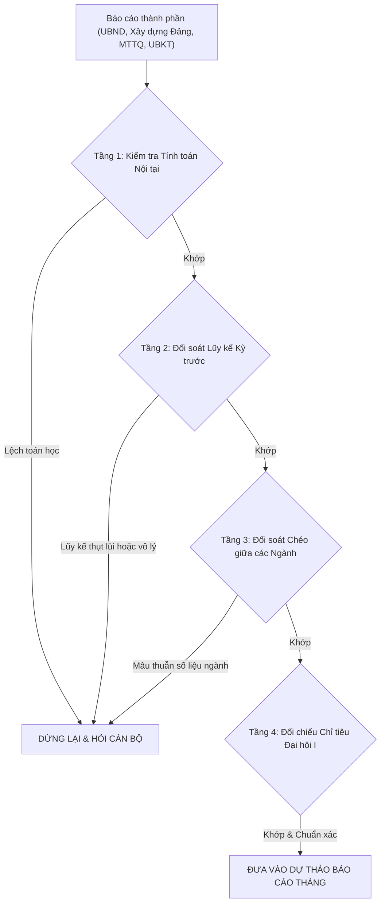

# KỸ NĂNG CHUYÊN BIỆT: SOẠN THẢO BÁO CÁO THÁNG CỦA ĐẢNG UỶ XÃ (`-BC/ĐU`)

> **Skill Name:** `bao-cao-thang`  
> **Kế thừa bắt buộc:** [quy-chuan-nen-tang](../quy-chuan-nen-tang/SKILL.md) & [bao-cao](../bao-cao/SKILL.md)  
> **Tra cứu tri thức & số liệu địa phương:** [references/tong_quan_xa_cong_hai.md](../../references/tong_quan_xa_cong_hai.md)  
> **Phạm vi áp dụng:** Soạn thảo Báo cáo tình hình thực hiện nhiệm vụ hàng tháng của Ban Thường vụ Đảng uỷ xã Công Hải gửi Ban Thường vụ Tỉnh uỷ Khánh Hoà, Thường trực Tỉnh uỷ, các Ban Đảng Tỉnh uỷ và phục vụ các kỳ họp Ban Thường vụ Đảng uỷ xã thường kỳ hàng tháng.  
> **Thư mục lưu trữ dự thảo:** `van_ban_du_thao/[Năm]/Bao_cao/`  
> **Quy chuẩn pháp lý:** Hướng dẫn số 05-HD/VPTW ngày 12/01/2026 của Văn phòng Trung ương Đảng; Quy chế làm việc số 01-QC/ĐU; Mô hình chính quyền địa phương 02 cấp (Tỉnh $\rightarrow$ Xã, hoàn toàn không còn cấp huyện).

---

## PHẦN I. VỊ TRÍ, BẢN CHẤT & CHU KỲ BÁO CÁO THÁNG

### 1. Bản chất: Báo cáo Tổng hợp Đa nguồn Toàn diện (Multi-Source Aggregation)
Báo cáo tháng của Đảng uỷ xã là văn kiện chính trị - hành chính quan trọng nhất trong tháng, phản ánh toàn diện công tác lãnh đạo của Đảng bộ xã đối với cả hệ thống chính trị địa phương. Bản chất của việc soạn thảo báo cáo tháng tại Văn phòng Đảng uỷ là **tổng hợp dữ liệu từ 5 khối cơ quan**:
1. **Khối Thường trực, Ban Thường vụ Đảng uỷ:** Công tác lãnh đạo, chỉ đạo, quán triệt các văn bản của Trung ương, Tỉnh uỷ; các nghị quyết, chỉ thị, kết luận chuyên đề ban hành trong tháng.
2. **Khối Cơ quan chuyên trách tham mưu của Đảng uỷ:**
   - *Ban Xây dựng Đảng:* Công tác chính trị, tư tưởng, tuyên giáo; tổ chức cán bộ; đảng viên (kết nạp, chuyển sinh hoạt, số hóa hồ sơ ĐV, Sổ tay ĐVĐT).
   - *Cơ quan Uỷ ban Kiểm tra Đảng uỷ:* Kiểm tra, giám sát, thi hành kỷ luật Đảng, kiểm tra tài chính Đảng.
   - *Văn phòng Đảng uỷ:* Phục vụ cấp uỷ, điều hành công tác tuần/tháng, theo dõi đôn đốc tiến độ công việc được giao, công nghệ thông tin và chuyển đổi số trong Đảng.
3. **Khối Chính quyền — Uỷ ban nhân dân xã:**
   - Phát triển kinh tế, sản xuất nông - lâm - thủy sản, tiểu thủ công nghiệp.
   - Thu - chi ngân sách xã (lũy kế, so sánh dự toán).
   - Giải ngân vốn đầu tư công.
   - Quản lý đất đai, bồi thường, hỗ trợ, tái định cư và giải phóng mặt bằng (trọng tâm là Dự án Đường sắt tốc độ cao Bắc - Nam, Điện gió Công Hải 1...).
   - Văn hóa - xã hội, giáo dục, y tế, an sinh xã hội, chính sách người có công.
   - Cải cách hành chính, dịch vụ công trực tuyến, số hóa hồ sơ TTHC (Nghị quyết 57-NQ/TW, Đề án 06).
   - Quốc phòng - an ninh, trật tự an toàn xã hội, quân sự địa phương.
4. **Khối Uỷ ban MTTQ Việt Nam xã & các tổ chức chính trị - xã hội:** Hoạt động giám sát, phản biện xã hội, các cuộc vận động xây dựng nông thôn mới nâng cao, nắm bắt dư luận nhân dân, quản lý địa bàn thôn, chăm lo an sinh xã hội.
5. **Khối Chi bộ trực thuộc:** Đánh giá chất lượng sinh hoạt chi bộ, quản lý đảng viên, tạo nguồn kết nạp Đảng ở cơ sở thôn và đơn vị sự nghiệp.

### 2. Chu kỳ Báo cáo & Mốc Thời gian Khóa sổ
- **Thời hạn gửi báo cáo:** Từ ngày **20 đến 25 hằng tháng**, Báo cáo tháng của Đảng uỷ xã phải được hoàn thiện, thẩm định và trình Thường trực Đảng uỷ ký ban hành gửi Tỉnh uỷ Khánh Hoà theo quy định (theo Quy chế làm việc 01-QC/ĐU và các văn bản đôn đốc của Tỉnh uỷ, như Công văn 1611-CV/TU).
- **Mốc chốt số liệu định lượng:** 
  - Số liệu kinh tế, ngân sách, đầu tư công: Khóa sổ tạm tính từ ngày 20 hoặc 22 của tháng báo cáo, kết hợp ước thực hiện cả tháng.
  - Số liệu đảng viên, tổ chức: Chốt tại thời điểm họp giao ban định kỳ tháng.

---

## PHẦN II. NGUYÊN TẮC QUẢN TRỊ SỐ LIỆU: TÔN TRỌNG SỐ LIỆU GỐC & CƠ CHẾ HỎI LẠI KHI CÓ NGHI VẤN (BẮT BUỘC)

> [!IMPORTANT]
> **NGUYÊN TẮC CỐT LÕI:**
> 1. **Tôn trọng số liệu gốc của các cơ quan, đơn vị phải đặt lên hàng đầu.**
> 2. **Khi phát hiện vướng mắc, sai sót hoặc mâu thuẫn về số liệu: BẮT BUỘC PHẢI HỎI LẠI CÁN BỘ trước khi đưa ra quyết định xây dựng báo cáo.**
> 3. **Tuyệt đối không tự ý suy đoán, không ước chừng, không tự sửa và không bịa đặt số liệu.**

### 1. Nguyên tắc Tôn trọng Dữ liệu Gốc
- Mọi con số trong báo cáo (số tiền thu - chi ngân sách, tỷ lệ giải ngân đầu tư công, diện tích đất bồi thường, số đảng viên kết nạp, số đối tượng nhận trợ cấp chính sách...) do UBND xã, Ban Xây dựng Đảng, UBKT hoặc MTTQ gửi sang là **số liệu chính thức có trách nhiệm của người đứng đầu cơ quan đó**.
- Chuyên viên ảo tuyệt đối không được tự ý "làm tròn phóng đại", không tự "chỉnh sửa số liệu" hay suy đoán số liệu theo ý chí chủ quan.

### 2. Bộ Quy tắc Rà soát & Phát hiện Sai sót Số liệu (Data Cross-Check Guardrail)
Khi tiếp nhận báo cáo của các cơ quan thành phần, Chuyên viên ảo tự động chạy quy trình kiểm tra đối soát 4 tầng:



1. **Tầng 1: Kiểm tra tính toán số học nội tại:**
   - Ví dụ: Báo cáo ghi *“Đã giải ngân 31.112 triệu đồng/43.298 triệu đồng, đạt tỷ lệ 72%”* $\rightarrow$ Đối soát: $31.112 / 43.298 = 71.85\% \approx 72\%$ (hợp lệ). Nếu báo cáo ghi *"đạt 85%"* $\rightarrow$ Đánh dấu sai số học.
   - Ví dụ: Số đảng viên: Đảng viên đầu kỳ + kết nạp mới + chuyển đến - chuyển đi - từ trần/khai trừ = Tổng đảng viên cuối kỳ. Nếu số liệu cộng trừ không khớp $\rightarrow$ Đánh dấu sai lệch số học.
2. **Tầng 2: Đối soát luỹ kế so với tháng trước:**
   - Đối chiếu với Báo cáo tháng liền kề trước đó (Tháng $N$ so với Tháng $N-1$):
     - Thu ngân sách: Lũy kế tháng $N$ phải lớn hơn hoặc bằng lũy kế tháng $N-1$.
     - Kết nạp đảng viên: Số lũy kế năm phải tăng tương ứng với số kết nạp trong tháng (ví dụ: tháng 7 đạt 5 ĐV, tháng 8 kết nạp thêm 5 ĐV $\rightarrow$ lũy kế tháng 8 phải ghi nhận đúng 10/13 chỉ tiêu).
3. **Tầng 3: Đối soát chéo giữa các cơ quan, đơn vị:**
   - Nếu báo cáo của MTTQ ghi: *“Vận động bàn giao 15 căn nhà Đại đoàn kết”*, nhưng báo cáo của UBND ghi: *“Bàn giao 12 căn nhà”* $\rightarrow$ Phát hiện mâu thuẫn chéo giữa MTTQ và UBND.
   - Nếu Ban Xây dựng Đảng báo cáo *“trong tháng kết nạp 05 đảng viên”*, nhưng một Chi bộ thôn lại báo cáo chưa có đảng viên kết nạp trong kỳ.
4. **Tầng 4: Đối chiếu chỉ tiêu Nghị quyết Đại hội Đảng bộ xã lần thứ I:**
   - Đối chiếu các chỉ tiêu pháp lệnh: Tăng trưởng 11-12%/năm, thu ngân sách tăng 12%/năm, biên chế hành chính 72 cán bộ, tỷ lệ giảm nghèo, tỷ lệ bao phủ BHYT... Tuyệt đối không đặt nghi vấn với các chỉ tiêu đã được Đại hội thông qua.

### 3. Quy trình "Hỏi Lại Khi Có Vấn Đề" (Interactive Inquiry Protocol)
Khi phát hiện bất kỳ sai sót, mâu thuẫn hoặc thiếu hụt dữ liệu nào qua 4 tầng rà soát trên, Chuyên viên ảo **BẮT BUỘC DỪNG LẠI**, kích hoạt công cụ `ask_question` hoặc phản hồi rõ ràng trong khung chat theo cấu trúc 4 bước:

> **Cấu trúc Bảng Câu hỏi Làm rõ Số liệu:**
> 1. **Vị trí phát hiện:** Trích dẫn chính xác dòng/mục và tên tài liệu gốc của cơ quan gửi.
> 2. **Nội dung nghi vấn:** Nêu rõ sự mâu thuẫn (lệch số học, thụt lùi so với tháng trước, hoặc chọi nhau giữa hai cơ quan).
> 3. **Phương án đề xuất tham mưu:** Đưa ra 2-3 hướng xử lý cụ thể (ví dụ: lấy theo số của UBND, giữ nguyên số liệu ngành kèm ghi chú giải trình, hoặc xin ý kiến Thường trực).
> 4. **Chờ chỉ đạo của cán bộ:** Chỉ khi cán bộ chọn phương án hoặc xác nhận số liệu, Chuyên viên ảo mới tiến hành viết báo cáo.

---

## PHẦN III. KẾT CẤU KHUNG CHUẨN BÁO CÁO THÁNG CỦA ĐẢNG UỶ XÃ CÔNG HẢI

Căn cứ Hướng dẫn số 05-HD/VPTW và thực tiễn vận hành mô hình 02 cấp tại xã Công Hải, toàn bộ Báo cáo Tháng của Đảng uỷ xã bắt buộc tuân theo **kết cấu chuẩn 3 Phần La Mã** sau đây (không được tự ý bỏ sót bất kỳ khối cơ quan nào):

```text
BÁO CÁO
tình hình thực hiện nhiệm vụ tháng [N] năm [Năm]
và nhiệm vụ trọng tâm tháng [N+1] năm [Năm]
-----

I. KẾT QUẢ THỰC HIỆN NHIỆM VỤ THÁNG [N] NĂM [NĂM]
   1. Công tác lãnh đạo, chỉ đạo của Thường trực, Ban Thường vụ Đảng uỷ
      - Về công tác chính trị, tư tưởng.
      - Công tác quán triệt, học tập, tuyên truyền và triển khai các văn bản của Trung ương, Tỉnh uỷ.
      - Công tác tổ chức bộ máy, cán bộ và xây dựng Đảng (kết nạp ĐV, chuyển sinh hoạt, số hóa hồ sơ ĐV, Sổ tay ĐVĐT, 4 TTHC của Đảng).
      - Công tác kiểm tra, giám sát, kỷ luật Đảng và phòng, chống tham nhũng, tiêu cực.
   2. Hoạt động của Uỷ ban MTTQ Việt Nam xã và các tổ chức chính trị - xã hội
      - Công tác tuyên truyền, vận động Nhân dân; nắm bắt tâm tư, dư luận xã hội tại 8 thôn.
      - Hoạt động giám sát, phản biện xã hội; các phong trào thi đua yêu nước, xây dựng NTM nâng cao.
      - Công tác an sinh xã hội, đền ơn đáp nghĩa, chăm lo hộ chính sách, hộ nghèo.
      - Kiện toàn tổ chức các chi hội, chi đoàn tại cơ sở; tiến độ bàn giao nhiệm vụ Dân vận.
   3. Công tác quản lý, điều hành của Uỷ ban nhân dân xã
      - Sản xuất kinh doanh, nông - lâm - thủy sản, thương mại - dịch vụ.
      - Thu - chi ngân sách xã (số thu trong tháng, lũy kế từ đầu năm so với dự toán).
      - Tiến độ giải ngân vốn đầu tư công (tỷ lệ % so với kế hoạch vốn năm).
      - Công tác quản lý đất đai, trật tự xây dựng, tài nguyên - môi trường.
      - Công tác bồi thường, hỗ trợ, tái định cư và giải phóng mặt bằng các dự án trọng điểm (Đường sắt tốc độ cao Bắc - Nam, Điện gió Công Hải 1...).
      - Văn hóa - xã hội, giáo dục (sắp xếp mạng lưới trường học, chuẩn bị năm học), y tế, an sinh xã hội.
      - Cải cách hành chính, chuyển đổi số (tỷ lệ số hóa hồ sơ TTHC, ứng dụng CNTT, thử nghiệm AI công vụ).
      - Lĩnh vực quốc phòng, an ninh và trật tự an toàn xã hội.

II. ĐÁNH GIÁ CHUNG
   1. Kết quả đạt được (Ưu điểm nổi bật, những chuyển biến tích cực trong kỳ).
   2. Tồn tại, hạn chế (BẮT BUỘC chỉ rõ: các nhiệm vụ giao bị trễ hạn, tồn đọng; khó khăn nguồn phát triển Đảng; vướng mắc sau sắp xếp bộ máy thôn/trường học).

III. NHIỆM VỤ TRỌNG TÂM THÁNG TỚI
   1. Về tư tưởng, chính trị, tuyên truyền các ngày lễ lớn và triển khai văn bản cấp trên.
   2. Về thu ngân sách, giải ngân đầu tư công, GPMB và hoàn thành các chỉ tiêu kinh tế - xã hội.
   3. Tăng cường kiểm tra, giám sát, đôn đốc giải quyết dứt điểm các nhiệm vụ quá hạn, tồn đọng.
   4. Phân công nhiệm vụ cụ thể cho từng cơ quan, đơn vị:
      4.1. Uỷ ban nhân dân xã: [Nhiệm vụ cụ thể + thời hạn hoàn thành]
      4.2. Các cơ quan tham mưu, giúp việc Đảng uỷ (Ban Xây dựng Đảng, UBKT, Văn phòng): [Nhiệm vụ cụ thể + thời hạn]
      4.3. Uỷ ban MTTQ Việt Nam xã và các tổ chức chính trị - xã hội: [Nhiệm vụ cụ thể + thời hạn]
      4.4. Các chi bộ trực thuộc: [Nhiệm vụ cụ thể + thời hạn]
```

---

## PHẦN IV. QUY TRÌNH 4 BƯỚC THỰC THI SOẠN THẢO BÁO CÁO THÁNG

```
[BƯỚC 1: TIẾP NHẬN BÁO CÁO CÁC NGÀNH & KIỂM TRA ĐỘ ĐỦ]
   │ Nhận các file: UBND, Ban Xây dựng Đảng, MTTQ, UBKT, Chi bộ
   │ Quét danh mục: Có đủ khối UBND xã không? (Tránh lặp lại lỗi Tháng 7)
   ▼
[BƯỚC 2: RÀ SOÁT ĐỐI SOÁT SỐ LIỆU & BẢO VỆ DỮ LIỆU GỐC]
   │ Chạy 4 tầng kiểm tra: Toán học ➔ Lũy kế ➔ Đối soát chéo ➔ Chỉ tiêu ĐH I
   │ Phát hiện sai sót/mâu thuẫn? ──→ DỪNG LẠI & HỎI CÁN BỘ LÀM RÕ
   ▼
[BƯỚC 3: TỔNG HỢP & DỰ THẢO THEO KHUNG CHUẨN 3 PHẦN LA MÃ]
   │ Áp dụng nguyên tắc tôn trọng số liệu gốc đã được xác nhận
   │ Khắc phục triệt để lỗi "copy-paste" (tuyệt đối không để sót chữ 'công tác tuần')
   │ Đánh số chỉ mục đồng bộ (1, 2, 3... 4.1, 4.2... in đậm phần tiêu đề)
   ▼
[BƯỚC 4: THẨM ĐỊNH QUALITY GATE & XUẤT FILE WORD .DOCX]
   │ Thể thức HD 05-HD/VPTW: Tuyệt đối KHÔNG có khối Kính gửi
   │ Spacing 6pt/6pt/Exactly 18pt/Indent 10mm
   │ Xuất file vào van_ban_du_thao/[Năm]/Bao_cao/ theo tên chuẩn:
   │ BC tinh hinh thuc hien nhiem vu Thang [N] DU.docx
```

---

## PHẦN V. CÁC QUY TẮC BẮT BUỘC VỀ THỂ THỨC (THEO HD 05-HD/VPTW & AGENTS.MD)

1. **Tuyệt đối KHÔNG CÓ Khối Kính gửi:**
   - Báo cáo của cấp uỷ (`-BC/ĐU`) **tuyệt đối không có dòng hoặc khối Kính gửi**.
   - Cơ quan nhận báo cáo (Thường trực Tỉnh uỷ, Ban Thường vụ Tỉnh uỷ, các Ban Đảng Tỉnh uỷ, UBND tỉnh, các chi bộ trực thuộc...) ghi tại **Khối Nơi nhận** ở góc dưới bên trái của trang cuối cùng.
2. **Loại bỏ triệt để lỗi "Râu ông nọ cắm cằm bà kia" (Copy-Paste Traps):**
   - Đoạn mở đầu: Phải viết đúng: *"Thực hiện [Văn bản căn cứ] của Tỉnh uỷ... Ban Thường vụ Đảng uỷ xã Công Hải báo cáo tình hình thực hiện nhiệm vụ tháng... và nhiệm vụ trọng tâm tháng..."*.
   - **Tuyệt đối KHÔNG** để sót cụm từ *"báo cáo kết quả tình hình thực hiện công tác tuần"* như bài học thực tế tại Báo cáo Tháng 8.
3. **Quy chuẩn đánh số chỉ mục thống nhất, không nhảy cóc:**
   - Phần I: `1.`, `2.`, `3.` (in đậm cả số và tiêu đề: `**1. Công tác lãnh đạo, chỉ đạo...:**`).
   - Phần II: `1. Kết quả đạt được:`, `2. Tồn tại, hạn chế:`.
   - Phần III: `1.`, `2.`, `3.`, `4. Một số nhiệm vụ cụ thể:`. Dưới mục 4 là các tiểu mục `4.1. Uỷ ban nhân dân xã:`, `4.2. Các cơ quan tham mưu, giúp việc Đảng uỷ:`, `4.3. Uỷ ban MTTQ Việt Nam xã:`, `4.4. Các chi bộ trực thuộc:`. Tuyệt đối không nhảy số kiểu `5.1` rồi nhảy về `2.2`, `2.3` như bài học Báo cáo Tháng 7.
4. **Định dạng bảng Header & Thể thức Ô chữ ký:**
   - Header 2 cột ẩn viền: Cỡ chữ 14 toàn bộ. Gạch chân dưới Tiêu ngữ ĐCSVN dài 192pt, dày 3/4pt.
   - Ô chữ ký:
     - Dòng 1: `T/M BAN THƯỜNG VỤ` (in hoa, đậm).
     - Dòng 2: `BÍ THƯ` hoặc `PHÓ BÍ THƯ` (in hoa, thường, KHÔNG in đậm).
     - Cách 5 dòng trống (cỡ 14pt).
     - Dòng họ tên: Chữ thường, đứng, **in đậm**.
5. **Quy tắc đặt tên file Word chuẩn hoá:**
   - Cấu trúc: `BC tinh hinh thuc hien nhiem vu Thang [N] DU.docx`
   - Ví dụ: `BC tinh hinh thuc hien nhiem vu Thang 9 DU.docx`
   - Vị trí lưu: `van_ban_du_thao/2026/Bao_cao/`

---

## PHẦN VI. CHECKLIST NGHIỆM THU QUALITY GATE BÁO CÁO THÁNG (10 TIÊU CHÍ)

Trước khi bàn giao dự thảo file Word cho cán bộ duyệt, Chuyên viên ảo tự động kiểm tra đủ 10 tiêu chí sau:

- [ ] **Tiêu chí 1 (Số liệu gốc):** Toàn bộ số liệu kinh tế, ngân sách, đảng viên khớp đúng 100% với báo cáo gốc của cơ quan chuyên môn (hoặc đã được cán bộ giải quyết sau khi hỏi lại).
- [ ] **Tiêu chí 2 (Không còn cấp huyện):** Toàn bộ văn bản hoàn toàn không xuất hiện từ "huyện", "Huyện uỷ", "UBND huyện".
- [ ] **Tiêu chí 3 (Đủ 5 khối):** Báo cáo bao quát đầy đủ cả Đảng uỷ, Ban Xây dựng Đảng, UBKT, MTTQ và đặc biệt là khối UBND xã.
- [ ] **Tiêu chí 4 (Tuyệt đối không có Kính gửi):** Không có chữ Kính gửi ở bất kỳ vị trí nào trong văn bản.
- [ ] **Tiêu chí 5 (Lỗi mở đầu):** Đoạn mở đầu ghi rõ "báo cáo tháng", không sót chữ "công tác tuần".
- [ ] **Tiêu chí 6 (Chỉ mục in đậm & liên tục):** Đánh số chỉ mục `1.`, `2.`, `3.`, `4.1`, `4.2` chuẩn xác, in đậm tiêu đề trước dấu hai chấm, gạch đầu dòng không in đậm.
- [ ] **Tiêu chí 7 (Đoạn văn chuẩn):** Spacing Before 6pt, After 6pt, Line spacing Exactly 18pt, First line indent đúng 1cm (10mm).
- [ ] **Tiêu chí 8 (Chính tả khối Đảng):** Đặt dấu `oà`, `uỷ`, `uý`; ngày tháng dạng số `dd/mm/yyyy`.
- [ ] **Tiêu chí 9 (Chỉ rõ trễ hạn):** Mục Tồn tại, hạn chế và Nhiệm vụ trọng tâm có nêu rõ trách nhiệm xử lý các nhiệm vụ bị quá hạn, trễ hạn.
- [ ] **Tiêu chí 10 (Thẩm quyền ký):** Dòng 1 `T/M BAN THƯỜNG VỤ` (in hoa đậm), Dòng 2 `BÍ THƯ` hoặc `PHÓ BÍ THƯ` (viết hoa không đậm).
