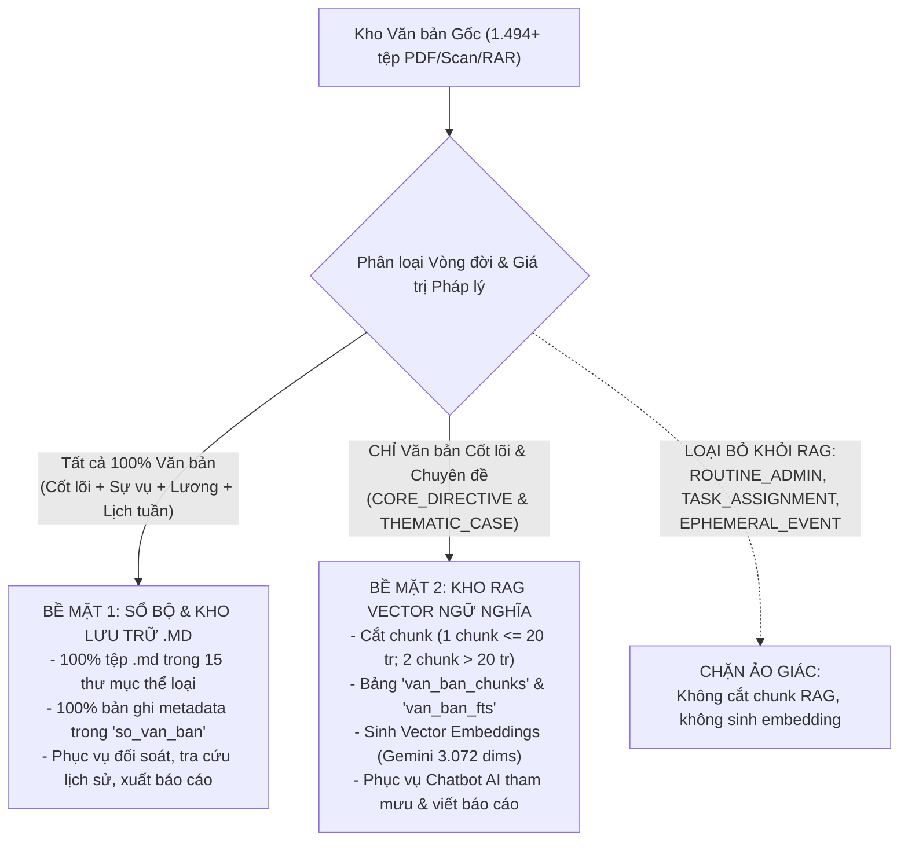

# KỸ NĂNG: BÓC TÁCH, CHUẨN HOÁ MARKDOWN & NẠP KHO RAG VĂN BẢN ĐẢNG UỶ

> **Skill Name:** `boc-tach-van-ban-rag`  
> **Kế thừa bắt buộc:** [quy-chuan-nen-tang](../quy-chuan-nen-tang/SKILL.md)  
> **Kho nguồn mặc định:** `references/1. ĐẢNG UỶ BAN HÀNH NHIỆM KỲ 2025-2030 (30-9-2026)/`  
> **Kho Markdown đầu ra:** `references/Văn bản Đảng uỷ Ban hành 25-30/`  
> **Bảng đối chiếu Master:** `data/danh_muc_van_ban_di_master.xlsx`  
> **CSDL đích:** `data/chuyen_vien_ao.db` (`so_van_ban`, `van_ban_chunks`, `van_ban_fts`, `van_ban_lien_ket`)

---

## PHẦN I. NGUYÊN TẮC BẤT BIẾN & KIẾN TRÚC 2 BỀ MẶT TRI THỨC

### 1. Kiến trúc 2 Bề mặt Tri thức (Dual-Surface Knowledge Architecture)
Để vừa bảo đảm **100% văn bản được số hoá phục vụ tra cứu sổ bộ hành chính**, vừa **triệt tiêu hoàn toàn ảo giác (anti-hallucination)** trong tra cứu văn kiện chỉ đạo, hệ thống phân tách độc lập 2 bề mặt dữ liệu:



- **Bề mặt 1 — Sổ bộ & Lưu trữ Toàn văn (`so_van_ban` & kho `.md`):** Đạt **100%** toàn bộ các văn bản ban hành của Đảng uỷ xã. Mọi quyết định lương, phụ cấp, xếp loại chi bộ tháng, lịch công tác tuần, công văn giao việc thời vụ đều phải có tệp `.md` chuẩn thể thức và bản ghi metadata trong CSDL.
- **Bề mặt 2 — Kho Tri thức Tìm kiếm Ngữ nghĩa RAG Vector (`van_ban_chunks` & `van_ban_fts`):** **TUYỆT ĐỐI CHỈ NẠP** các văn bản nền tảng, định hướng lâu dài (`CORE_DIRECTIVE`) và chuyên đề lớn (`THEMATIC_CASE`). Không nạp văn bản sự vụ hành chính vào RAG vector.

### 2. Chốt chặn Độ mật (Secret Gatekeeper)
- Trước khi bóc tách hoặc gửi nội dung lên AI, luôn quét dấu `MẬT`, `TỐI MẬT`, `TUYỆT MẬT` (theo Quyết định `37-QĐ/ĐU` và Nghị định `63/2026/NĐ-CP`).
- Phát hiện độ mật $\rightarrow$ **dừng ngay lập tức, tuyệt đối không lưu vào `.md` công khai, không nạp vào RAG**, báo cáo trực tiếp cán bộ.

### 3. Bảo vệ CSDL & Sao lưu (Human-in-the-Loop)
- Trước khi thực hiện bất kỳ thao tác làm mới, ghi đè hoặc xoá dữ liệu lớn trong `data/chuyen_vien_ao.db`, **bắt buộc sao lưu tệp DB** vào thư mục `backups/` và xác nhận rõ phạm vi với cán bộ.

### 4. Quy tắc Chính tả Khối Đảng & Mô hình 02 Cấp
- Chuẩn hoá dấu tiếng Việt khối Đảng: `oà`, `uỷ`, `uý` (*Đảng uỷ*, *Khánh Hoà*, *Uỷ ban*); chuẩn Unicode NFC; chuyển mã `Ð` (`U+00D0`) thành `Đ` (`U+0110`).
- Ngày tháng trong nội dung và dòng định danh ghi dạng số `dd/mm/yyyy`.
- Mô hình chính quyền địa phương **02 cấp** (Tỉnh Khánh Hoà $\rightarrow$ Xã Công Hải; **không còn cấp huyện**). Giữ nguyên 100% số liệu gốc trong văn bản, không tự làm tròn hay suy đoán.

### 5. Quy tắc Quản lý Script & Tự động Dọn dẹp Script Dùng 1 Lần
- Mọi script Python hỗ trợ xử lý theo đợt (Batch Processing) tạo ra trong phiên làm việc (như `process_batch*.py`, `tmp_*.py`) **bắt buộc phải tự động xoá bỏ ngay lập tức** sau khi thực thi hoàn tất, tuyệt đối không để tồn đọng gây rác thư mục `scripts/`.

---

## PHẦN II. QUY TRÌNH 6 BƯỚC BÓC TÁCH & CHUẨN HOÁ THỰC CHIẾN

### Bước 1. Tiếp nhận, Giải nén & Phân loại Định dạng Tệp

1. **Xử lý Tệp Nén (`.zip`, `.rar`):**
   - Trong kho nguồn thực tế có thể tồn tại các tệp nén (như Tờ trình 15, 16 dạng `.rar`).
   - Sử dụng thư viện giải nén tự động (Python `zipfile`, `rarfile` hoặc `patool`) để bung tệp vào thư mục tạm.
   - Bóc tách riêng tệp văn bản chính (Tờ trình) và các tệp văn bản đính kèm (Dự thảo Kế hoạch, Đề án, Phụ lục số liệu) để xử lý độc lập, không để sót tài liệu bên trong tệp nén.
2. **Nhận diện Tệp TEXT vs Tệp SCAN:**
   - Dùng `pypdf.PdfReader` đọc lướt các trang. Nếu trích xuất được trên 100 ký tự chữ có nghĩa $\rightarrow$ gắn cờ `is_scan = False` (Văn bản Text).
   - Nếu toàn bộ các trang không trích xuất được chữ (chỉ là ảnh quét mộc đỏ) $\rightarrow$ gắn cờ `is_scan = True` (Văn bản Scan).

---

### Bước 2. Khớp nối 4 Tầng & Xử lý Lệch pha Dữ liệu Master

Vì tên tệp lưu trên đĩa và cột `File văn bản` trong `data/danh_muc_van_ban_di_master.xlsx` **không giống nhau**, tuyệt đối không so khớp theo tên tệp. Áp dụng tuần tự 4 tầng:

1. **Tầng 1 — Chuẩn hoá `(Số hiệu + Thể loại + Năm)`:**
   - Rút trích `(Cơ quan, Thể loại, Số + hậu tố chữ cái, Năm)` từ tên file; chuẩn hoá `Ð` $\rightarrow$ `Đ`, bỏ khoảng trắng quanh dấu `-`, bỏ số `0` thừa ở đầu (ví dụ `A32.65-ĐU-QÐ-0008-2026` $\rightarrow$ `8-QĐ/ĐU`, năm `2026`).
   - Nếu tên file thiếu mã loại hoặc gõ nhầm (ví dụ `A32.65-ĐU-0150-2026`, `CU`), suy luận thể loại từ tên thư mục cha (`BÁO CÁO` $\rightarrow$ `BC`, `CÔNG VĂN` $\rightarrow$ `CV`).
   - Khớp với cặp **`(Số ký hiệu chuẩn hoá, Năm ban hành)`** trong Excel Master (bắt buộc kèm `Năm` để tránh nhầm giữa các năm).
2. **Tầng 2 — Khớp theo Trích yếu trang 1:**
   - Với các tệp đặt tên tự do không có mã số (ví dụ `mời dự tập huấn...pdf`), đọc trang đầu để lấy trích yếu/số hiệu rồi đối chiếu với Excel Master.
3. **Tầng 3 — Tự lập hồ sơ trực tiếp từ PDF gốc:**
   - Với các tệp năm 2025 hoặc văn bản nội bộ không có dòng trong Excel Master: Đọc trực tiếp trang đầu & trang cuối PDF để trích xuất đầy đủ metadata (Số hiệu, Ngày, Trích yếu, Người ký).
4. **Tầng 4 — Xử lý Lệch pha & Số phụ hậu tố `a`:**
   - **Lệch pha thời gian:** Excel Master quản lý đến tháng 11/2026 (hơn 2.000 bản ghi), trong khi đĩa nguồn chốt đến 30/09/2026 (1.494 tệp). Các số cao cuối 2026 không có file PDF thì không sinh file .md ảo.
   - **Hậu tố chữ cái `a`:** Các văn bản phát sinh điều chỉnh mang số hiệu có chữ `a` (`137a-BC`, `160a-BC`, `161a-BC`, `174a-BC`, `129a-TB`, `0012a-KH`...) được định danh độc lập, bảo đảm không bị ghi đè vào văn bản số chính.
   - **Xử lý trùng số trong cùng năm:** Nếu 2 văn bản có cùng số hiệu do chuyển giao bộ máy (ví dụ `01-QĐ/ĐU` ngày 10/07/2025 và `01-QĐ/ĐU` ngày 15/08/2025), bổ sung ngày tháng `(dd-mm)` vào tên file để phân biệt.

---

### Bước 3. Sàng lọc Giá trị Sử dụng & Phân loại 6 Nhóm Vòng đời

Đọc nội dung/trích yếu từng tệp và phân loại chính xác vào **6 nhóm vòng đời CSDL** theo bảng quyết định:

| Nhóm Vòng đời (`nhom_vong_doi`) | Tiêu chí nhận diện nghiệp vụ | Xử lý Bề mặt 1 (Kho `.md` & `so_van_ban`) | Xử lý Bề mặt 2 (RAG Vector `chunks` & `fts`) |
| :--- | :--- | :--- | :--- |
| **1. `CORE_DIRECTIVE`**<br>*(Chỉ đạo Cốt lõi)* | `Nghị quyết`, `Quy chế`, `Quy định`, `Đề án`, `Chỉ thị`, `Phương án`; `Chương trình` hành động toàn khoá/năm; `Quyết định` ban hành quy chế, thành lập BCĐ/bộ máy; `Báo cáo` tổng kết/sơ kết thực hiện nghị quyết, kết luận, chỉ thị của Trung ương và Tỉnh uỷ. | **BẮT BUỘC** tạo file `.md` sạch & nạp metadata vào `so_van_ban`. | **BẮT BUỘC** cắt chunk (ngưỡng 20 tr), nạp `van_ban_chunks`, `van_ban_fts` và sinh Vector Embeddings (3.072 dims). |
| **2. `THEMATIC_CASE`**<br>*(Chuyên đề còn giá trị)* | `Kế hoạch` công tác chuyên đề lớn còn hiệu lực; `Kết luận` hội nghị BCH/BTV; `Tờ trình` xin chủ trương quan trọng; `Hướng dẫn` chuyên môn nghiệp vụ của Đảng uỷ; `Báo cáo` chuyên đề/đoàn kiểm tra, giám sát. | **BẮT BUỘC** tạo file `.md` sạch & nạp metadata vào `so_van_ban`. | **BẮT BUỘC** nạp toàn văn vào RAG vector như nhóm 1. |
| **3. `TASK_ASSIGNMENT`**<br>*(Giao việc, Đôn đốc)* | `Công văn` chỉ đạo, giao việc, đôn đốc các cơ quan chuyên môn theo thời hạn; công văn triển khai văn bản cấp trên có tính thời vụ. | **BẮT BUỘC** tạo file `.md` sạch & nạp metadata vào `so_van_ban`. | **LOẠI BỎ KHỎI RAG VECTOR** (tránh làm nhiễu ngữ nghĩa văn kiện nền tảng). |
| **4. `ROUTINE_ADMIN`**<br>*(Hành chính Định kỳ)* | `Báo cáo` tình hình công tác tuần/tháng định kỳ; `Quyết định` nâng bậc lương, phụ cấp thâm niên, công nhận/kết nạp đảng viên cá nhân lẻ; `Thông báo` phân công lịch trực tết, xếp loại chi bộ hàng tháng. | **BẮT BUỘC** tạo file `.md` sạch & nạp metadata vào `so_van_ban`. | **LOẠI BỎ KHỎI RAG VECTOR** (chống ảo giác số liệu cũ). |
| **5. `EPHEMERAL_EVENT`**<br>*(Sự vụ, Giấy mời)* | Giấy mời họp (`GM` hoặc CV mời dự hội nghị); Bản sao văn bản (`BS`); Giấy nghỉ phép, giới thiệu công tác; Thông báo thăm chúc mừng ngày truyền thống. | **BẮT BUỘC** tạo file `.md` sạch & nạp metadata vào `so_van_ban`. | **LOẠI BỎ KHỎI RAG VECTOR**. |
| **6. `BI_THAY_THE`**<br>*(Đã Hết Hiệu Lực)* | Văn bản đã có văn bản mới tuyên bố *"thay thế"*, *"bãi bỏ"*, *"hủy bỏ"*. | Giữ file `.md` lưu trữ, cập nhật trạng thái `BI_THAY_THE` trong `so_van_ban`. | **LOẠI BỎ KHỎI RAG VECTOR**; ghi quan hệ vào bảng `van_ban_lien_ket`. |

#### Quy tắc Gắn `ma_chuyen_de` Chuẩn
Gán chính xác theo 9 chuyên đề nghiệp vụ dựa trên ngữ nghĩa thực của văn bản:
- `CDS_DEAN06`: Chuyển đổi số, Nghị quyết 57, Đề án 06, Ban Chỉ đạo 57, IOC, Sổ tay Đảng viên điện tử.
- `XD_DANG_CAN_BO`: Tổ chức bộ máy, công tác cán bộ, đảng viên, bảo vệ chính trị nội bộ, tuyên giáo, dân vận.
- `KT_GIAM_SAT`: Kiểm tra, giám sát, thi hành kỷ luật Đảng, phòng chống tham nhũng, lãng phí, tiêu cực.
- `KINH_TE_NGAN_SACH`: Kinh tế, ngân sách, đầu tư công, nông thôn mới nâng cao, quản lý tài chính Đảng.
- `DAT_DAI_MOI_TRUONG`: Đất đai, bồi thường GPMB, khoáng sản, môi trường, trật tự xây dựng.
- `VAN_HOA_XA_HOI`: Giáo dục, y tế, văn hoá, chính sách an sinh, giảm nghèo, dân tộc Raglai, tôn giáo.
- `QUOC_PHONG_AN_NINH`: Quân sự địa phương, an ninh trật tự, công an xã, PCCC, phòng chống thiên tai.
- `VAN_PHONG_THI_DUA`: Quy chế làm việc, văn thư lưu trữ, thi đua khen thưởng, tổng hợp tham mưu của Văn phòng.
- `CD_DE_AN_DOI_MOI_NANG_CAO_CH`: Đề án đổi mới, nâng cao chất lượng hoạt động của hệ thống chính trị xã Công Hải.

---

### Bước 4. Quy chuẩn Bóc tách Nội dung & Xử lý Văn bản SCAN

#### 4.1. Cơ chế Phân hoá Xử lý SCAN vs TEXT
- **Văn bản TEXT (`is_scan = False`):**
  - Trích xuất toàn văn, làm sạch tiêu đề khuôn mẫu và chữ ký theo quy chuẩn mục 4.2.
  - Xử lý mở dòng gãy tiếng Việt (`unwrap_vietnamese_text`), chuẩn hoá chính tả Khối Đảng (`oà`, `uỷ`, `uý`).
- **Văn bản SCAN Sự vụ (`is_scan = True` & `nhom_vong_doi` $\in$ {ROUTINE_ADMIN, TASK_ASSIGNMENT, EPHEMERAL_EVENT}):**
  - Không chạy OCR toàn trang tốn token; bóc tách metadata chuẩn xác từ Excel/tên file/trang 1.
  - Tạo tệp `.md` lưu trữ theo mẫu:
    ```markdown
    [Thể loại] số [Số hiệu] ngày [dd/mm/yyyy] của [Cơ quan] về "[Trích yếu]". Người ký: [Họ tên].

    *Nội dung trích yếu pháp lý:* [Trích yếu đầy đủ].

    *Ghi chú:* Văn bản dạng ảnh quét (scan) lưu trữ phục vụ tra cứu sổ bộ và đối soát hành chính của Đảng bộ xã Công Hải nhiệm kỳ 2025 - 2030.
    ```
- **Văn bản SCAN Cốt lõi (`is_scan = True` & `nhom_vong_doi` $\in$ {CORE_DIRECTIVE, THEMATIC_CASE}):**
  - Bắt buộc kích hoạt Subagent thị giác chuyên sâu (hoặc giải nén trang ảnh qua `fitz` kết hợp mô hình OCR) để chuyển đổi toàn văn thành văn bản sạch trước khi đưa vào RAG.

#### 4.2. Quy chuẩn Rút gọn Thân bài Văn bản TEXT
1. **Loại bỏ hoàn toàn phần Tiêu đề / Tiêu ngữ khuôn mẫu ở đầu trang:**
   - Xoá: `ĐẢNG BỘ TỈNH KHÁNH HOÀ`, `ĐẢNG UỶ XÃ CÔNG HẢI`, dấu `*`, `Số ...-.../ĐU`, `ĐẢNG CỘNG SẢN VIỆT NAM`, đường kẻ ngang, `Công Hải, ngày ... tháng ... năm ...`, và tên loại đứng riêng lẻ (`KẾ HOẠCH`, `NGHỊ QUYẾT`...).
2. **Thay thế bằng ĐÚNG 1 DÒNG ĐỊNH DANH PHÁP LÝ ĐẦU BÀI:**
   ```text
   [Thể loại] số [Số hiệu] ngày [dd/mm/yyyy] của [Thẩm quyền/Cơ quan ban hành] về "[Trích yếu]". Người ký: [Họ tên].
   ```
   - *Quy chuẩn Cơ quan/Thẩm quyền:*
     - Ký `T/M BAN THƯỜNG VỤ` $\rightarrow$ `Ban Thường vụ Đảng uỷ xã Công Hải`
     - Ký `T/M ĐẢNG UỶ` $\rightarrow$ `Ban Chấp hành Đảng bộ xã Công Hải`
     - Ký `CHÁNH VĂN PHÒNG` / `PHÓ CHÁNH VĂN PHÒNG` $\rightarrow$ `Văn phòng Đảng uỷ xã Công Hải`
     - Ký `T/M BAN CHỈ ĐẠO` $\rightarrow$ `Ban Chỉ đạo 57 Đảng uỷ xã Công Hải`
3. **Loại bỏ hoàn toàn phần `Nơi nhận:` và khối `Chữ ký` cuối văn bản:**
   - Xoá toàn bộ khối Nơi nhận, chức vụ ký, timestamp điện tử lặp lại (`24-04-2026 15:21:14+07:00`, mộc ký số VNPT...).
   - **CHỐT BẢO VỆ PHỤ LỤC & BÁO CÁO CÁ NHÂN:** Chỉ cắt bỏ từ dòng `Nơi nhận:` đến hết chữ ký của phần đó. Toàn bộ **Phụ lục số liệu, Quy chế đính kèm, Danh sách đảng viên hoặc Báo cáo kiểm điểm cá nhân** nằm phía sau chữ ký **BẮT BUỘC GIỮ NGUYÊN TOÀN VĂN**.
4. **Chuẩn hoá Bảng biểu:**
   - Chuyển đổi toàn bộ bảng biểu sang định dạng Markdown chuẩn (`| Cột 1 | Cột 2 |`), không làm rớt tiêu đề cột hoặc gộp dòng sai lệch.

---

### Bước 5. Quy tắc Chia Chunk & Giới hạn Ký tự Embedding

Áp dụng thống nhất trên số trang gốc của văn bản:

1. **Văn bản $\le 20$ trang:**
   - **1 văn bản = 1 chunk duy nhất** trong RAG (chứa toàn bộ nội dung sạch).
   - Đặt đầu chunk bằng Dòng định danh pháp lý chuẩn hoá.
2. **Văn bản $> 20$ trang:**
   - **Chia làm ĐÚNG 2 chunk** (`Chunk 1/2` và `Chunk 2/2`).
   - Cắt tại **ranh giới tự nhiên gần giữa văn bản nhất**: ranh giới giữa các Phần La Mã lớn, giữa Báo cáo tập thể và Báo cáo cá nhân, hoặc giữa Thân bài và Phụ lục.
   - **Tuyệt đối không cắt ngang giữa bảng biểu hoặc giữa một điều khoản.**
   - Chunk 2/2 bắt buộc lặp lại Dòng định danh pháp lý đầu bài kèm nhãn tiếp nối:
     `[Thể loại] số [Số hiệu] ngày [dd/mm/yyyy] của [Cơ quan] về "[Trích yếu]". Người ký: [Họ tên]. (Phần 2/2 - Tiếp theo: [Tên phần])`
3. **Giới hạn an toàn API Vector Embedding:**
   - Khi gọi `server.services.embedding_service.get_embedding(text)` (Gemini Embedding API, model `gemini-embedding-001`, 3.072 chiều), **bắt buộc cắt chuỗi `chunk_text[:5000]` ký tự** để sinh vector. Việc này vừa bảo đảm lấy trọn vẹn ngữ nghĩa trọng tâm phần đầu văn bản, vừa tránh triệt để lỗi timeout kết nối mạng hoặc lỗi vượt kích thước payload (HTTP 400/500).

---

### Bước 6. Lưu trữ Kho Markdown (`.md`) & Ghi nhận CSDL SQLite

#### 6.1. Cây Thư mục Lưu trữ 15 Thể loại
Lưu trữ đồng bộ tại `references/Văn bản Đảng uỷ Ban hành 25-30/` gồm 15 thư mục chuẩn:

```text
references/Văn bản Đảng uỷ Ban hành 25-30/
├── Báo cáo/
├── Chỉ thị/
├── Chương trình/
├── Công văn/
├── Đề án/
├── Hướng dẫn/
├── Kế hoạch/
├── Kết luận/
├── Nghị quyết/
├── Phương án/
├── Quy chế/
├── Quy định/
├── Quyết định/
├── Thông báo/
└── Tờ trình/
```

#### 6.2. Thuật toán Sanitize Tên File trên Windows
Để chống triệt để lỗi `OSError: [Errno 22] Invalid argument` trên hệ điều hành Windows:
1. Xoá toàn bộ ký tự ngắt dòng ẩn: `.replace("\n", " ").replace("\r", " ")`.
2. Thay thế ký tự cấm hệ điều hành bằng khoảng trắng: `re.sub(r'[\/\\:\*\?"<>\|]', ' ', clean_ty)`.
3. Thu gọn nhiều khoảng trắng liên tiếp và cắt độ dài an toàn $\le 60$ ký tự:
   ```python
   safe_title = re.sub(r'[\/\\:\*\?"<>\|\n\r]', ' ', clean_ty)
   safe_title = re.sub(r'\s+', ' ', safe_title).strip()[:60]
   ```
4. **Cấu trúc tên file `.md` chuẩn:**
   ```text
   A32.65-[Cơ_quan]-[Thể_loại]-[Số_4_chữ_số]-[Năm] [Trích yếu rút gọn].md
   ```
   *Ví dụ:*
   - `Kế hoạch/A32.65-ĐU-KH-0069-2026 Rà soát làm sạch dữ liệu ĐV.md`
   - `Báo cáo/A32.65-ĐU-BC-0143-2026 Tổng kết 10 năm thực hiện Kết luận số 114-KL TW.md`
   - `Quyết định/A32.65-ĐU-QĐ-0084-2026 Nâng lương thường xuyên đối với cán bộ.md`

#### 6.3. Mẫu Nội dung File `.md` Chuẩn Hoá
Mỗi tệp `.md` đều chứa phần YAML Frontmatter đầy đủ để phục vụ máy học và công cụ tra cứu tự động:

```markdown
---
doc_id: "144-KH/ĐU_2026-10-13_DU"
so_hieu: "144-KH/ĐU"
the_loai: "KH"
co_quan_ban_hanh: "Ban Thường vụ Đảng uỷ xã Công Hải"
ngay_ban_hanh: "13/10/2026"
nguoi_ky: "Nguyễn Xuân Hoàng"
nhom_vong_doi: "THEMATIC_CASE"
ma_chuyen_de: "XD_DANG_CAN_BO"
trang_thai_hieu_luc: "CON_HIEU_LUC"
so_trang_goc: 5
so_chunks: 1
nguon_file: "A32.65-ĐU-KH-0144-2026 Rà soát dữ liệu ĐV.pdf"
---

Kế hoạch số 144-KH/ĐU ngày 13/10/2026 của Ban Thường vụ Đảng uỷ xã Công Hải về "Triển khai rà soát, làm sạch, chuẩn hoá, đối soát dữ liệu tổ chức đảng, đảng viên trong Đảng bộ xã Công Hải". Người ký: Nguyễn Xuân Hoàng.

[Nội dung toàn văn sạch từ phần I đến hết nội dung văn bản + Phụ lục đính kèm, đã loại bỏ Tiêu ngữ, Nơi nhận và Khối chữ ký]
```

#### 6.4. Nạp vào CSDL `data/chuyen_vien_ao.db`
- **Bảng `so_van_ban` (100% văn bản):** Ghi nhận `doc_id`, `file_hash` (MD5 bắt buộc), `so_hieu_vb`, `the_loai_vb`, `trich_yeu`, `nhom_vong_doi`, `ma_chuyen_de`, `nguoi_ky`, `ngay_ban_hanh`, `file_path`.
- **Bảng `van_ban_chunks` & `van_ban_fts` (Chỉ văn bản Cốt lõi):** Ghi `chunk_text`, `context_header`, và `embedding` (BLOB vector 3.072 chiều).
- **Bảng `van_ban_lien_ket`:** Ghi nhận các quan hệ `CAN_CU`, `THAY_THE`, `SUA_DOI_BO_SUNG`.

---

## PHẦN III. BỘ TIÊU CHÍ NGHIỆM THU (QUALITY GATE) 6 CHỐT CHẶN

Một đợt bóc tách chỉ được coi là hoàn tất khi vượt qua trọn vẹn 6 chốt chặn nghiệm thu sau:

1. **Chốt chặn 1 — Tuyệt đối Không Lọt Tài liệu MẬT:**
   - 100% văn bản quét qua bộ lọc từ khoá mật. Phát hiện dấu mật phải dừng và báo cáo riêng cho cán bộ, không xuất file `.md` và không nạp DB.
2. **Chốt chặn 2 — Phủ kín 100% Số hoá Kho `.md` và Sổ bộ (`so_van_ban`):**
   - 100% tệp văn bản gốc có mặt trên đĩa đều có tệp `.md` chuẩn thể thức tương ứng trong 15 thư mục thể loại và có bản ghi đầy đủ trong bảng `so_van_ban` (kèm mã băm `file_hash`).
3. **Chốt chặn 3 — Độ Thuần khiết Tuyệt đối của Kho RAG Vector:**
   - Kho RAG (`van_ban_chunks` & `van_ban_fts`) chỉ chứa văn bản `CORE_DIRECTIVE` và `THEMATIC_CASE`.
   - Tuyệt đối không để lọt văn bản `ROUTINE_ADMIN`, `TASK_ASSIGNMENT`, `EPHEMERAL_EVENT` vào kho vector.
   - 100% chunks trong `van_ban_chunks` đều sinh thành công Vector Embedding (`embedding IS NOT NULL`).
4. **Chốt chặn 4 — Sạch Rác Hành chính & Chuẩn Dòng Định danh Đầu bài:**
   - 100% tệp `.md` và chunk RAG không còn tồn tại chuỗi `ĐẢNG CỘNG SẢN VIỆT NAM`, `Nơi nhận:`, rác timestamp ký số VNPT; mở đầu bằng đúng 1 dòng định danh pháp lý có đầy đủ Người ký.
5. **Chốt chặn 5 — Chuẩn Ngưỡng Chunk 20 Trang:**
   - 100% tệp $\le 20$ trang chỉ có đúng 1 chunk; 100% tệp $> 20$ trang có đúng 2 chunk cắt tại ranh giới tự nhiên, không làm gãy bảng biểu.
6. **Chốt chặn 6 — Dọn dẹp Script Tạm & Đồng bộ Bản đồ Mã nguồn:**
   - Toàn bộ các file script Python bổ trợ dùng một lần đã được tự động xoá sạch khỏi thư mục `scripts/`.
   - Đã chạy lệnh `python scripts/generate_code_map.py --update-map` để cập nhật [CODEBASE_MAP.md](../../CODEBASE_MAP.md).
