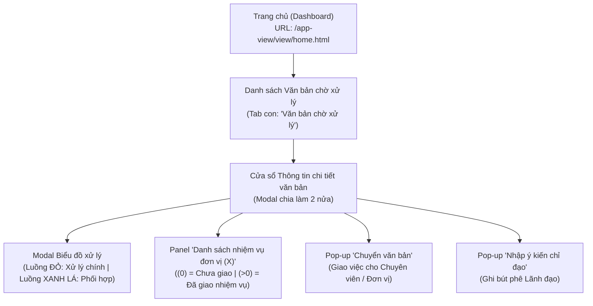
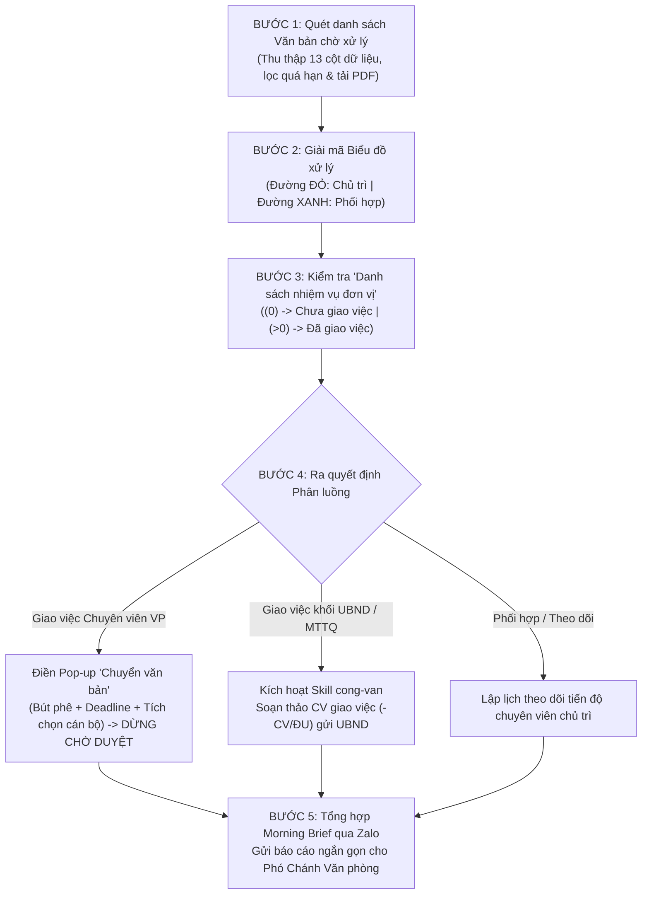

# KỸ NĂNG: XỬ LÝ VĂN BẢN ĐẾN TRÊN HỆ THỐNG ĐIỀU HÀNH TÁC NGHIỆP CÁC CƠ QUAN ĐẢNG

> **Skill Name:** `xu-ly-van-ban-den`  
> **Kế thừa bắt buộc:** [quy-chuan-nen-tang](../quy-chuan-nen-tang/SKILL.md)  
> **Hệ thống mục tiêu:** Hệ thống Thông tin Điều hành tác nghiệp các cơ quan Đảng (`https://dhtn.dcs.vn`)  
> **Đơn vị áp dụng:** Văn phòng Đảng uỷ xã Công Hải, tỉnh Khánh Hoà  
> **Chủ tài khoản thụ hưởng:** Đồng chí Ngô Hoàng Việt - Phó Chánh Văn phòng Đảng uỷ (kiêm Quản trị viên hệ thống cấp xã)

---

## PHẦN I. CĂN CỨ PHÁP LÝ, NGUYÊN TẮC BẢO MẬT & MÔ HÌNH VẬN HÀNH

### 1. Căn cứ pháp lý nền tảng
1. **Quy chế số 07-QC/TW** ngày 31/10/2025 của Ban Bí thư về tổ chức, quản lý, sử dụng và bảo vệ hệ thống mạng máy tính của Đảng.
2. **Quy chế số 06-QC/VPTW** ngày 26/4/2025 của Văn phòng Trung ương Đảng về quản lý, sử dụng phần mềm Hệ thống thông tin điều hành tác nghiệp trong các cơ quan đảng.
3. **Hướng dẫn số 09-HD/VPTW** ngày 03/6/2026 của Văn phòng Trung ương Đảng về xử lý văn bản điện tử trên hệ thống thông tin điều hành tác nghiệp trong các cơ quan đảng.
4. **Công văn số 1980-CV/VPTW** ngày 26/11/2025 của Văn phòng Trung ương Đảng kèm Hướng dẫn khai thác sử dụng trí tuệ nhân tạo (AI) cho cán bộ, đảng viên trong các cơ quan đảng.
5. **Quy chuẩn thể thức văn bản Đảng:** Hướng dẫn số 05-HD/VPTW ngày 12/01/2026 của Văn phòng Trung ương Đảng.

### 2. Ba nguyên tắc bất biến khi AI tương tác với Hệ thống thật
- **Nguyên tắc môi trường mạng (Internet vs Intranet):** Trên môi trường Internet (`dhtn.dcs.vn`), hệ thống chỉ xử lý văn bản thông thường, hoàn toàn **KHÔNG CÓ VĂN BẢN MẬT**. Văn bản có độ mật ("Mật", "Tối mật") chỉ được hiển thị và xử lý khi người dùng truy cập từ mạng thông tin diện rộng chuyên dùng của Đảng có gắn thiết bị mã hoá của Ban Cơ yếu Chính phủ.
- **Nguyên tắc "Human-in-the-Loop" (Con người quyết định):** Chuyên viên ảo đóng vai trò trợ lý kỹ thuật chuẩn bị dữ liệu, đọc trích xuất, phát hiện hạn xử lý, gợi ý bút phê và tự động điền form. AI **TUYỆT ĐỐI KHÔNG** tự ý bấm các nút xác nhận có tính pháp lý như: nút đỏ `[⏩ Chuyển văn bản]`, nút `[💾 Ghi lại]` ý kiến chỉ đạo, nút `[Hoàn thành]` hoặc `[Trả lại]`. Mọi thao tác gửi đi phải dừng lại để cán bộ kiểm tra và tự tay bấm nút.
- **Tuyệt đối không lưu mật khẩu:** AI hoạt động trên phiên làm việc (session) đã được cán bộ đăng nhập sẵn trên trình duyệt. Tuyệt đối không yêu cầu, không lưu trữ mã PIN, mật khẩu tài khoản hoặc thiết bị lưu khoá bí mật.

### 3. Sơ đồ nhân sự & Luồng phân phối tại Văn phòng Đảng uỷ xã Công Hải
- **Đầu mối tiếp nhận ban đầu:** Đồng chí Hồ Thị Thuý Nhi (Văn thư) tiếp nhận văn bản đến điện tử, vào sổ, gắn dấu đến điện tử $\rightarrow$ Chuyển cho Chánh Văn phòng (đồng chí Nguyễn Đăng Quang) hoặc chuyển trực tiếp cho Phó Chánh Văn phòng (đồng chí Ngô Hoàng Việt).
- **Đầu mối phân phối & lãnh đạo:**
  - Đồng chí Nguyễn Đăng Quang (Chánh Văn phòng) và đồng chí Ngô Hoàng Việt (Phó Chánh Văn phòng).
  - Phân công giao việc cho các chuyên viên Văn phòng Đảng uỷ:
    + **Katơr Vế:** Chuyên viên văn phòng.
    + **Mai Thị Thuỷ:** Chuyên viên văn phòng.
    + **Lê Thị Bích Thuỷ:** Chuyên viên văn phòng.
    + **Hồ Thị Thuý Nhi:** Văn thư cơ quan.
  - Phân công giao việc cho các cơ quan chuyên trách tham mưu: **Ban Xây dựng Đảng xã**, **Cơ quan Uỷ ban Kiểm tra Đảng uỷ xã**.
- **Đặc thù khối Chính quyền (UBND xã) và Mặt trận (MTTQ xã):** Hệ thống phần mềm ĐHTN của Đảng **không tạo nhiệm vụ trực tiếp** sang khối chính quyền và mặt trận. Do đó, đối với các chỉ đạo của cấp trên cần UBND xã hoặc Mặt trận tổ chức thực hiện, Văn phòng Đảng uỷ bắt buộc phải **ban hành Công văn giao việc (-CV/ĐU)** của Đảng uỷ xã gửi sang.

---

## PHẦN II. ĐẶC TẢ GIAO DIỆN HỆ THỐNG ĐIỀU HÀNH TÁC NGHIỆP (`dhtn.dcs.vn`)



### 1. Bảng danh sách "Văn bản chờ xử lý" (13 Cột thông tin chuẩn)
Truy cập qua URL chính: `https://dhtn.dcs.vn/app-view/theme/admin-ex/pages/main.zul` (hoặc click widget `Chờ xử lý` trên Dashboard):
- **Cột 1 (Checkbox):** Chọn một hoặc nhiều văn bản.
- **Cột 2 (STT):** Số thứ tự hiển thị.
- **Cột 3 (Thao tác):** Cụm 8 icon hành động nhanh: *[Chia sẻ]*, *[Tạo nhiệm vụ đơn vị]*, *[Chuyển văn bản]*, *[Lưu/Tạo hồ sơ]*, *[Biểu đồ xử lý]*, *[Hoàn thành xử lý]*, *[Ghi chú]*, *[Trả lại]*.
- **Cột 4 (Đơn vị ban hành):** Tên cơ quan gửi (Ví dụ: *UBND xã Công Hải*, *Văn phòng Tỉnh uỷ Khánh Hoà*, *Ban Tuyên giáo và Dân vận Tỉnh uỷ*...).
- **Cột 5 (Số, ký hiệu):** Số hiệu văn bản gốc (Hyperlink mở chi tiết).
- **Cột 6 (Trích yếu nội dung văn bản):** Nội dung trích yếu, kèm badge phân loại như `[CT]` (Chủ trì), `[PH]` (Phối hợp).
- **Cột 7 (Thể loại văn bản):** Quyết định, Kế hoạch, Báo cáo, Thông báo, Công văn, Tờ trình...
- **Cột 8 (Độ khẩn):** Thường, Khẩn, Thượng khẩn, Hoả tốc.
- **Cột 9 (Độ mật):** Thường (trên môi trường Internet luôn là Thường).
- **Cột 10 (Trạng thái văn bản):** Chờ xử lý.
- **Cột 11 (Thời gian nhận):** Ngày giờ nhận văn bản (dd/mm/yyyy).
- **Cột 12 (Ý kiến chuyển):** Bút phê chỉ đạo luân chuyển của Lãnh đạo cấp trên (Ví dụ: *"Cập nhật, tham mưu thực hiện' Lưu HS"*, *"Trình TTĐU biết; VP tham mưu chỉ đạo thực hiện"*).
- **Cột 13 (File văn bản):** Tên file PDF đã đóng dấu điện tử (`*_dadongdau.pdf`), kèm icon tải xuống.

### 2. Cửa sổ Modal "Thông tin chi tiết văn bản"
Chia thành 2 nửa rõ rệt:
- **Nửa bên trái (Thông tin & Danh mục accordion):**
  1. *Khung Thông tin chi tiết:* Trích yếu, Số ký hiệu, Người ký, Ngày ban hành, Mã định danh (`A32.65-...`), Thể loại, Đơn vị ban hành.
  2. *Khung File đính kèm:* Danh sách các tệp PDF/Doc kèm nút xem trực tiếp (con mắt), in và tải về.
  3. *Panel Danh sách người gửi đến.*
  4. *Panel Danh sách ký duyệt.*
  5. *Panel Danh sách cho ý kiến.*
  6. *Panel Danh sách trình duyệt.*
  7. **`Panel Danh sách nhiệm vụ đơn vị (X)`:** **Mục cốt lõi để xác định văn bản này đã được giao việc chưa**.
- **Nửa bên phải (PDF Viewer nhúng):**
  - Hiển thị trực tiếp toàn văn văn bản PDF có chữ ký số và con dấu đỏ. Cho phép AI đọc toàn văn để phân tích chỉ tiêu, nhiệm vụ.
- **Thanh tác vụ dưới đáy (17 nút chức năng):**
  - Nhóm 1: `[X Đóng]`, `[Gán tag]`, `[Công khai]`, `[Tạo lịch họp]`, `[Lưu tài liệu]`, `[Lưu/Tạo hồ sơ]`, `[Ghi chú]`, `[Tạo nhiệm vụ đơn vị]`, `[Chia sẻ]`, `[Xem luân chuyển]`, `[Biểu đồ xử lý]`, `[Trả lại]`.
  - Nhóm 2 (Trọng tâm): `[Hoàn thành]`, `[Nhập ý kiến chỉ đạo]`, `[Tạo phiếu trình]`, `[Tạo dự thảo]`, `[Chuyển văn bản]` (Nút màu đỏ nổi bật nhất).

---

## PHẦN III. QUY TRÌNH 5 BƯỚC THAO TÁC CỦA CHUYÊN VIÊN ẢO (ACTIONABLE PLAYBOOK)

Khi được kích hoạt để xử lý văn bản đến, AI Agent thực hiện tuần tự và chính xác theo 5 bước sau:



### Bước 1: Quét danh sách "Văn bản chờ xử lý" & Thu thập dữ liệu
1. **Truy cập:** Mở tab `Văn bản chờ xử lý` (từ Dashboard click widget `Chờ xử lý (209)` hoặc Menu Sidebar `Văn bản đến >> Văn bản chờ xử lý`).
2. **Thu thập dữ liệu từng dòng:**
   - Đọc Số ký hiệu (Cột 5), Đơn vị ban hành (Cột 4), Trích yếu (Cột 6), Thời gian nhận (Cột 11), Ý kiến chuyển (Cột 12).
   - Kiểm tra trạng thái màu sắc: Nếu dòng chữ đỏ là `Văn bản quá hạn` (Ưu tiên P0); nếu chữ đen in đậm là `Văn bản chưa đọc`; nếu chữ xám là `Văn bản đã đọc`.
3. **Tải file đính kèm:** Click icon download tại Cột 13 (`File văn bản`) hoặc click mở chi tiết văn bản để đọc tệp PDF nhúng ở nửa màn hình bên phải.

### Bước 2: Giải mã "Biểu đồ xử lý" (Xác định vai trò của Phó CVP)
1. **Thao tác:** Click icon `Biểu đồ xử lý` tại Cột 3 (hoặc click nút `Biểu đồ xử lý` tại thanh công cụ dưới đáy cửa sổ chi tiết).
2. **Quy tắc phân tích đường nối:**
   - **🔴 Đường nối MÀU ĐỎ = XỬ LÝ CHÍNH:** Cán bộ đích của đường nối màu đỏ là **Người chủ trì trực tiếp giải quyết văn bản**.
     - Nếu đường đỏ trỏ về đồng chí Ngô Hoàng Việt $\rightarrow$ Đồng chí là người trực tiếp tham mưu. AI kích hoạt luồng tự động soạn dự thảo văn bản trả lời/phiếu trình.
     - Nếu đường đỏ trỏ về chuyên viên khác (ví dụ: Lê Thị Bích Thuỷ, Katơr Vế, Mai Thị Thuỷ) $\rightarrow$ Chuyên viên đó là người chủ trì.
   - **🟢 Đường nối MÀU XANH LÁ = PHỐI HỢP:** Cán bộ đích là người phối hợp/giám sát.
     - Nếu đường xanh lá trỏ về đồng chí Ngô Hoàng Việt (kèm biểu tượng sao vàng) $\rightarrow$ Đồng chí giữ vai trò **Lãnh đạo Văn phòng giám sát, kiểm soát tiến độ** của chuyên viên. AI kích hoạt luồng theo dõi hạn và đối soát chất lượng tham mưu.
   - **⚫ Đường nối MÀU ĐEN = NHẬN ĐỂ BIẾT:** Chỉ lưu trữ theo dõi thông tin.
3. **Đóng modal:** Bấm nút `[X]` hoặc `[X Đóng]` để quay lại an toàn.

### Bước 3: Kiểm tra panel "Danh sách nhiệm vụ đơn vị" trong văn bản đến
1. **Thao tác:** Trong cửa sổ *Thông tin chi tiết văn bản*, cuộn chuột ở khung bên trái xuống dưới mục *Danh sách trình duyệt* để tìm tiêu đề **`Danh sách nhiệm vụ đơn vị (X)`**.
2. **Đánh giá trạng thái:**
   - **Trường hợp (X) = 0 (`Danh sách nhiệm vụ đơn vị (0)`):**
     - Văn bản này **CHƯA ĐƯỢC GIAO NHIỆM VỤ**.
     - AI đánh giá nội dung: Nếu văn bản chứa nhiệm vụ cần triển khai $\rightarrow$ Đưa vào diện đề xuất Lãnh đạo giao việc hoặc tạo nhiệm vụ mới.
   - **Trường hợp (X) > 0 (`Danh sách nhiệm vụ đơn vị (>0)`):**
     - Văn bản này **ĐÃ ĐƯỢC GIAO NHIỆM VỤ THÀNH CÔNG**.
     - AI đọc 7 cột trong bảng: `Tên nhiệm vụ`, `Đơn vị chủ trì`, `Ngày bắt đầu`, `Ngày hoàn thành`, `Kết quả thực hiện`, `Trạng thái`.
     - Tự động trích xuất deadline hoàn thành để đưa vào danh mục theo dõi tiến độ.

### Bước 4: Thao tác tự động hoá Pop-up "Chuyển văn bản" (Giao việc chuyên viên)
Khi đồng chí Phó Chánh Văn phòng yêu cầu chuyển giao văn bản cho chuyên viên:
1. **Mở Pop-up:** Click nút đỏ `[⏩ Chuyển văn bản]` ở góc dưới cùng bên phải cửa sổ chi tiết.
2. **Điền thông tin tự động:**
   - **Ô `Ý kiến chuyển (2000)`:** Nhập nội dung chỉ đạo ngắn gọn, rõ ràng theo công thức:
     `Giao đ/c [Tên chuyên viên] chủ trì nghiên cứu, tham mưu [Nhiệm vụ cụ thể]; báo cáo lãnh đạo VP trước ngày [dd/mm/yyyy].`
   - **Ô `Hạn xử lý`:** Chọn ngày deadline qua datepicker (thường từ 3 - 5 ngày làm việc tuỳ tính chất khẩn).
   - **Mục `Danh sách cá nhân`:** Nhập tên và tích chọn đích danh chuyên viên tương ứng:
     - Đ/c **Katơr Vế**: Mảng công tác dân tộc, tôn giáo, các hội quần chúng, phối hợp chính quyền.
     - Đ/c **Mai Thị Thuỷ**: Mảng công tác văn phòng, kiểm tra đảng uỷ, nội chính.
     - Đ/c **Lê Thị Bích Thuỷ**: Mảng công tác tài chính đảng, chuyển đổi số, ngân sách.
     - Đ/c **Hồ Thị Thuý Nhi**: Mảng văn thư, lưu trữ, tiếp nhận phát hành văn bản.
   - **Tùy chọn `☑️ Gửi tin nhắn thông báo`:** Luôn giữ trạng thái tích chọn để hệ thống gửi thông báo tới điện thoại cán bộ.
3. **QUY TẮC AN TOÀN HUMAN-IN-THE-LOOP (DỪNG CHỜ):**
   - AI điền xong toàn bộ form và **DỪNG LẠI NGAY LẬP TỨC**.
   - Báo cáo đồng chí Phó CVP qua khung chat:
     *"Đã nạp sẵn ý kiến chuyển giao việc cho đ/c [Tên chuyên viên] với hạn chót [dd/mm/yyyy]. Kính mời đồng chí kiểm tra trên màn hình và tự tay bấm nút đỏ [Chuyển văn bản] để phê duyệt."*
   - Tuyệt đối không tự kích hoạt sự kiện click của nút đỏ `Chuyển văn bản`.

### Bước 5: Tự động khởi tạo Công văn giao việc (-CV/ĐU) gửi UBND / Mặt trận
Khi văn bản đến từ cấp trên (Tỉnh uỷ, UBND tỉnh) yêu cầu triển khai các nhiệm vụ thuộc thẩm quyền của chính quyền cấp xã (về quản lý đất đai, giải ngân đầu tư, an sinh xã hội, trật tự đô thị, chuyển đổi số hành chính):
1. Nhận diện do hệ thống ĐHTN của Đảng không tạo nhiệm vụ sang UBND xã/MTTQ xã được.
2. AI tự động kích hoạt kỹ năng **`cong-van`** (`.agents/skills/cong-van/SKILL.md`).
3. Trích xuất căn cứ pháp lý từ văn bản đến (Số hiệu, ngày ban hành, cơ quan ban hành, trích yếu).
4. Tự động soạn thảo dự thảo Công văn giao việc của Ban Thường vụ Đảng uỷ xã gửi UBND xã:
   - File Word lưu tại: `van_ban_du_thao/2026/Cong_van/CV giao viec UBND xa [Trich yeu rut gon].docx`.
   - Đúng chuẩn thể thức Hướng dẫn số 05-HD/VPTW (lề 30-15-20-20mm, spacing 6pt-6pt-18pt, thụt dòng 1cm, bảng ẩn Kính gửi).
   - Nội dung giao việc rõ ràng: Giao UBND xã tổ chức triển khai, phân công cơ quan chuyên môn, ấn định thời hạn báo cáo kết quả về Ban Thường vụ Đảng uỷ xã.

---

## PHẦN IV. MẪU BẢN TIN ZALO NHẮC VIỆC & MẪU BÚT PHÊ CHỈ ĐẠO CHUẨN

### 1. Template Bản tin Morning Brief qua Zalo (Gửi Phó CVP mỗi sáng)
```markdown
🇻🇳 VĂN PHÒNG ĐẢNG UỶ XÃ CÔNG HẢI - BẢN TIN ĐIỀU HÀNH TÁC NGHIỆP SÁNG [dd/mm/yyyy]
Kính gửi: Đồng chí Ngô Hoàng Việt - Phó Chánh Văn phòng Đảng uỷ

Hệ thống ĐHTN hiện ghi nhận: [X] văn bản đến chờ xử lý ([Y] quá hạn, [Z] sắp đến hạn).

🚨 1. VĂN BẢN QUÁ HẠN / SẮP ĐẾN HẠN (CẦN XỬ LÝ GẤP):
- [Số hiệu] ([Cơ quan gửi]): [Trích yếu ngắn gọn].
  + Vai trò: [Chủ trì (Luồng đỏ) / Giám sát chuyên viên [Tên] (Luồng xanh)].
  + Hạn chót: [dd/mm/yyyy] (Đã quá hạn / Còn 1 ngày).
  + Đề xuất của AI: [Gợi ý hành động: Đôn đốc chuyên viên / Soạn CV giao việc].

📋 2. VĂN BẢN MỚI TIẾP NHẬN CHƯA GIAO NHIỆM VỤ:
- [Số hiệu]: [Trích yếu].
  + Gợi ý phân công: Giao đ/c [Katơr Vế / Mai Thuỷ / Bích Thuỷ], hạn [dd/mm/yyyy].
- [Số hiệu]: [Trích yếu cần UBND xã thực hiện].
  + Gợi ý hành động: AI đã soạn sẵn dự thảo CV giao việc UBND xã tại thư mục dự thảo.

Kính báo đồng chí xem xét, chỉ đạo!
```

### 2. Thư viện Mẫu Bút phê Chỉ đạo chuẩn trong Pop-up "Chuyển văn bản"
- **Mẫu 1 (Giao tham mưu văn bản chỉ đạo):**
  `Giao đ/c [Tên] chủ trì nghiên cứu nội dung văn bản; khẩn trương tham mưu dự thảo Kế hoạch/Công văn của Đảng uỷ xã triển khai thực hiện; trình Thường trực Đảng uỷ trước ngày [dd/mm/yyyy].`
- **Mẫu 2 (Giao theo dõi, đôn đốc UBND xã):**
  `Giao đ/c [Tên] theo dõi, đôn đốc UBND xã triển khai thực hiện đúng tiến độ; tổng hợp báo cáo Thường trực Đảng uỷ định kỳ.`
- **Mẫu 3 (Chuyển lưu trữ, cập nhật dữ liệu):**
  `Cập nhật dữ liệu, theo dõi và lưu hồ sơ công việc theo quy định.`
- **Mẫu 4 (Trình xin ý kiến Thường trực Đảng uỷ):**
  `Kính trình đồng chí Bí thư / Phó Bí thư Thường trực Đảng uỷ xem xét, cho ý kiến chỉ đạo.`

---

## PHẦN V. MA TRẬN XỬ LÝ NGOẠI LỆ & BẢO ĐẢM AN TOÀN HỆ THỐNG

| Tình huống ngoại lệ | Nguy cơ | Biện pháp xử lý của Chuyên viên ảo |
| :--- | :--- | :--- |
| **Văn bản đến có độ Mật** (dù chạy trên mạng Internet) | Vi phạm Luật Bảo vệ BMNN | Nếu phát hiện từ khoá MẬT/TỐI MẬT trên trích yếu hoặc ảnh scan, **dừng đọc ngay lập tức**, không cache, không gửi Zalo, báo đồng chí xử lý thủ công. |
| **Phiên làm việc (Session) hết hạn** | Bị đẩy về màn hình đăng nhập | Không tự ý gõ mật khẩu; thông báo đồng chí đăng nhập lại trên tab ẩn danh rồi AI tiếp tục. |
| **Tệp PDF là bản scan chất lượng thấp** | Không bóc tách được text | Sử dụng module OCR nội bộ (`doc_reader.py`) để nhận dạng ký tự quang học; đối soát kỹ các con số và ngày tháng. |
| **Văn bản có nhiều phụ lục phức tạp** | Bỏ sót bảng số liệu | Mở từng tệp đính kèm trong danh sách `File đính kèm (X)` để phân tích đầy đủ các biểu dự toán/danh sách đi kèm. |
| **Chuyên viên nộp dự thảo tham mưu chậm** | Trễ hạn giao việc của Đảng uỷ | Căn cứ ngày hoàn thành trong `Danh sách nhiệm vụ đơn vị`, AI tự động đưa vào danh sách cảnh báo đôn đốc trước 01 ngày. |

---

## PHẦN VI. VAI TRÒ CHUYÊN VIÊN THAM MƯU ĐỘC LẬP SONG SONG

Nhằm phục vụ đồng chí Phó Chánh Văn phòng trong việc **rèn luyện, nâng cao năng lực cho đội ngũ chuyên viên Văn phòng Đảng uỷ (Katơr Vế, Mai Thị Thuỷ, Lê Thị Bích Thuỷ)**:
- Đối với mỗi văn bản đến quan trọng được giao cho chuyên viên nghiên cứu, Chuyên viên ảo sẽ **chủ động lập 01 Bản tham mưu độc lập song song** (Đề cương tóm tắt + Các vấn đề trọng tâm cần lưu ý + Dự thảo văn bản mẫu).
- Bản tham mưu này gửi riêng cho đồng chí Phó Chánh Văn phòng để đồng chí dùng làm **thước đo đối chiếu, phản biện và chỉnh sửa** khi các chuyên viên nộp sản phẩm dự thảo lên, bảo đảm chất lượng tham mưu của Văn phòng Đảng uỷ xã Công Hải luôn đạt chuẩn mực chính trị cao nhất.
