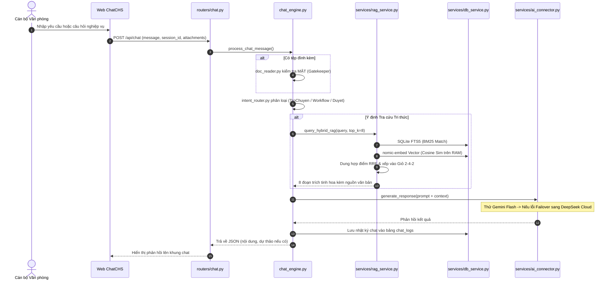
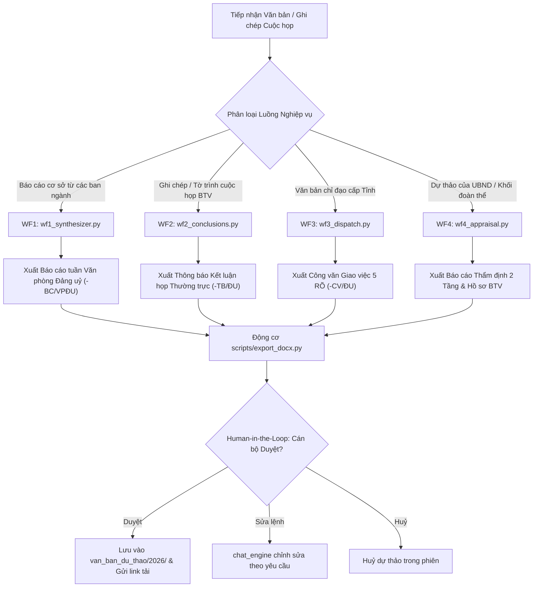
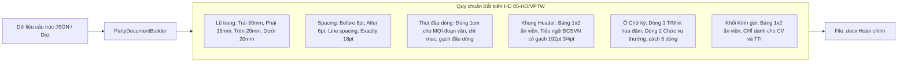
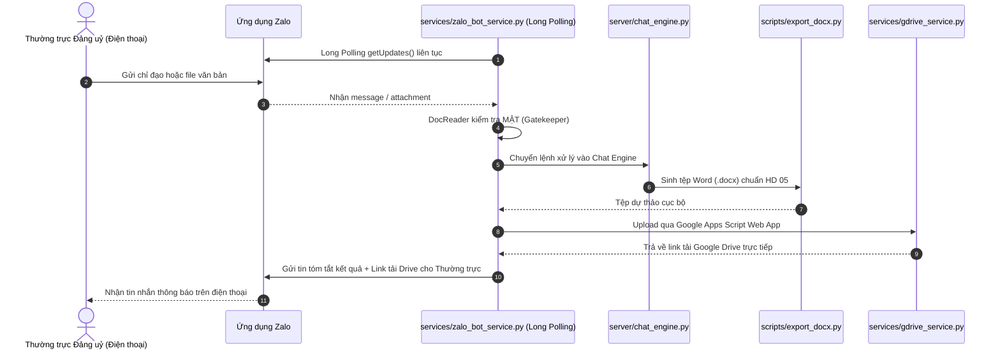

# BẢN ĐỒ KIẾN TRÚC MÃ NGUỒN & HƯỚNG DẪN ĐỊNH HƯỚNG CHO AI
## HỆ THỐNG CHUYÊN VIÊN ẢO VĂN PHÒNG ĐẢNG UỶ XÃ CÔNG HẢI
*(Phiên bản 2.2.0 — Cập nhật phục vụ mô hình chính quyền địa phương 02 cấp & HD 05-HD/VPTW)*

---

## 🧭 1. HƯỚNG DẪN ĐỊNH HƯỚNG NHANH CHO AI (AI ONBOARDING QUICKSTART)

> [!IMPORTANT]
> **Dành cho mọi AI Agent (Antigravity, Cursor, Claude Code, Copilot, DeepSeek, v.v.):**
> Khi bắt đầu một phiên làm việc mới về **lập trình, sửa lỗi hoặc phát triển tính năng**, bạn chỉ cần đọc tài liệu này kết hợp cùng `AGENTS.md` là có thể nắm trọn 100% bối cảnh kỹ thuật, luồng xử lý và các quy tắc ngầm của toàn bộ dự án mà không cần quét lại thủ công từng file.

### Bộ 3 Tài liệu Cốt lõi của Dự án:
1. [AGENTS.md](file:///e:/Viet%20Design/Chuy%C3%AAn%20vi%C3%AAn%20%E1%BA%A3o/AGENTS.md): **Kim chỉ nam Nghiệp vụ Đảng & Thể thức** — Quy định bắt biến về chính quyền địa phương 02 cấp (không còn cấp huyện), chính tả Khối Đảng (`oà`, `uỷ`, `uý`), định dạng xuất Word HD 05-HD/VPTW, 15 Kỹ năng Đảng và nguyên tắc an toàn thông tin (Human-in-the-Loop, tuyệt đối không đụng mật khẩu, không đưa tài liệu MẬT lên AI).
2. [CODEBASE_MAP.md](file:///e:/Viet%20Design/Chuy%C3%AAn%20vi%C3%AAn%20%E1%BA%A3o/CODEBASE_MAP.md) *(Tài liệu này)*: **Bản đồ Kỹ thuật & Luồng Dữ liệu** — Sơ đồ kiến trúc phân tầng, luồng thực thi (Mermaid), thiết kế CSDL SQLite WAL, bảng ánh xạ các file/hàm và các cạm bẫy kỹ thuật (Gotchas).
3. [README.md](file:///e:/Viet%20Design/Chuy%C3%AAn%20vi%C3%AAn%20%E1%BA%A3o/README.md): **Tổng quan Dự án & Vận hành** — 4 trụ cột năng lực, 3 kênh tương tác và hướng dẫn triển khai máy chủ VPS Ubuntu (45.119.82.227).

---

## 🏗️ 2. KIẾN TRÚC PHÂN TẦNG TỔNG THỂ (SYSTEM ARCHITECTURE)

Hệ thống được thiết kế theo mô hình **Modular Layered Architecture** chặt chẽ, chia làm 5 tầng rõ rệt:

```text
┌────────────────────────────────────────────────────────────────────────────────────────┐
│                        TẦNG 1: GIAO DIỆN & KÊNH TƯƠNG TÁC (PRESENTATION)                │
│   ┌────────────────────────┐  ┌───────────────────────────┐  ┌───────────────────────┐  │
│   │ 1. Antigravity IDE     │  │ 2. Web Công Hải Số        │  │ 3. Zalo Bot Di Động   │  │
│   │    (15 Đảng Skills)    │  │    (ChatCHS Single-Page)  │  │    (Long Polling 24/7)│  │
│   └───────────┬────────────┘  └─────────────┬─────────────┘  └───────────┬───────────┘  │
└───────────────┼─────────────────────────────┼────────────────────────────┼──────────────┘
                │                             ▼                            │
┌───────────────┼──────────────────────────────────────────────────────────┼──────────────┐
│               │        TẦNG 2: ĐỊNH TUYẾN & ĐIỀU PHỐI (API ROUTING)      │              │
│               │   server/app.py (FastAPI Lifespan, CORS, Static Mounting)│              │
│               │   ├── routers/auth.py (Xác thực cán bộ & Zalo OTP bảo mật 2FA)  │              │
│               │   ├── routers/chat.py (Endpoint Chat, Upload, Xuất Word) │              │
│               │   ├── routers/knowledge.py (Quản trị RAG, Chunk, Commit) │              │
│               │   ├── routers/admin.py (Model AI, Danh bạ, Tasks, CI/CD) │              │
│               │   └── routers/zalo_webhook.py (Tiếp nhận sự kiện Zalo)   │              │
└───────────────┼─────────────────────────────┬────────────────────────────┼──────────────┘
                ▼                             ▼                            ▼
┌─────────────────────────────────────────────────────────────────────────────────────────┐
│                    TẦNG 3: ĐỘNG CƠ HỘI THOẠI & WORKFLOWS CHUYÊN TRÁCH                   │
│   server/chat_engine.py (Bộ điều phối trung tâm: Intent Router, HITL State Machine)     │
│   ├── workflows/wf1_synthesizer.py  --> Tổng hợp Báo cáo tuần (-BC/VPĐU)                │
│   ├── workflows/wf2_conclusions.py  --> Thông báo Kết luận họp Thường trực (-TB/ĐU)     │
│   ├── workflows/wf3_dispatch.py     --> Công văn Giao việc từ VB Tỉnh (-CV/ĐU)          │
│   └── workflows/wf4_appraisal.py    --> Thẩm định 2 Tầng & Xuất hồ sơ BTV (-BC/VPĐU)    │
└─────────────────────────────────────────────┬───────────────────────────────────────────┘
                                              ▼
┌─────────────────────────────────────────────────────────────────────────────────────────┐
│                    TẦNG 4: CÁC DỊCH VỤ HẠT NHÂN (CORE SERVICES & ENGINES)               │
│   ├── services/ai_connector.py      --> Dual-Engine Failover (Gemini <-> DeepSeek <-> Ollama)
│   ├── services/rag_service.py       --> Hybrid RAG (Sliding Window + FTS5 BM25 + Vector + RRF)
│   ├── services/embedding_service.py --> nomic-embed-text Vector Generator & Cosine Sim  │
│   ├── services/db_service.py        --> SQLite WAL Unified Database Driver (07 Bảng)    │
│   ├── services/knowledge_loader.py  --> Selective Knowledge Injection (Giỏ 2-4-2)       │
│   ├── services/scheduler_service.py --> Quản trị hẹn giờ, nhắc việc 07:30, 16:30, T6    │
│   ├── services/zalo_bot_service.py  --> Long Polling Runner, Command Parser             │
│   ├── services/zalo_api.py          --> Zalo Message Formatter & 2000-char Splitter     │
│   ├── services/gdrive_service.py    --> Google Apps Script Cloud Drive Uploader         │
│   └── utils/text_processing.py      --> Chuẩn hoá chính tả Khối Đảng (oà, uỷ, uý)       │
└─────────────────────────────────────────────┬───────────────────────────────────────────┘
                                              ▼
┌─────────────────────────────────────────────────────────────────────────────────────────┐
│                    TẦNG 5: CÔNG CỤ XUẤT BẢN & LƯU TRỮ DỮ LIỆU                           │
│   ├── scripts/export_docx.py        --> Engine sinh Word (.docx) chuẩn Hướng dẫn 05     │
│   ├── scripts/doc_reader.py         --> Bóc tách PDF/DOCX & Chốt chặn Độ mật (Gatekeeper)│
│   ├── data/chuyen_vien_ao.db        --> SQLite WAL Database                             │
│   ├── references/                   --> Tri thức địa phương & Kho .md sạch 25-30        │
│   └── van_ban_du_thao/2026/         --> Kho lưu trữ dự thảo kết quả (.docx)             │
└─────────────────────────────────────────────────────────────────────────────────────────┘
```

---

## 🔄 3. SƠ ĐỒ CÁC LUỒNG THỰC THI CỐT LÕI (MERMAID PIPELINES)

### 3.1. Luồng 1: Xử lý Hội thoại & Hybrid RAG (Web Chat Flow)


### 3.2. Luồng 2: Bốn Quy trình Tham mưu Tự động (Workflows WF1 - WF4)


### 3.3. Luồng 3: Động cơ Sinh tệp Word Chuẩn Thể thức HD 05 (`scripts/export_docx.py`)


### 3.4. Luồng 4: Zalo Bot Di Động 24/7 & Tự động Đẩy Drive


---

## 📊 4. THIẾT KẾ CƠ SỞ DỮ LIỆU SQLITE WAL (`data/chuyen_vien_ao.db`)

Được quản trị tập trung tại [server/services/db_service.py](file:///e:/Viet%20Design/Chuy%C3%AAn%20vi%C3%AAn%20%E1%BA%A3o/server/services/db_service.py).
Mọi kết nối bắt buộc qua context manager `get_db_connection()` với chế độ **WAL (Write-Ahead Logging)** và timeout 30 giây để đảm bảo đọc/ghi đồng thời an toàn.

| Tên bảng | Mục đích & Nghiệp vụ cốt lõi | Các trường mấu chốt |
| :--- | :--- | :--- |
| **`danh_ba_can_bo`** | Danh bạ cán bộ Đảng uỷ, HĐND, UBND, 08 thôn, 21 chi bộ | `id, ho_ten, so_dien_thoai, chuc_vu, co_quan, don_vi, zalo_id` |
| **`so_nhiem_vu`** | Quản lý nhiệm vụ "5 Rõ", chống trùng khi trượt tháng | `id, task_fingerprint (MD5), co_quan_chu_tri, noi_dung, han_hoan_thanh, trang_thai` |
| **`so_tieu_chi`** | 20 chỉ tiêu Đại hội Đảng bộ khoá I & 19 chỉ tiêu NQ57 CĐS | `id, ma_chi_tieu, ten_chi_tieu, chi_tieu_2026, chi_tieu_2030, thuc_te_hien_tai, trang_thai_den` |
| **`so_van_ban`** | Sổ đăng ký văn bản đi/đến, vòng đời, căn cứ pháp lý | `id, so_hieu, trich_yeu, the_loai, co_quan_ban_hanh, ngay_ban_hanh, duong_dan_file` |
| **`van_ban_chunks`** | Phục vụ Hybrid RAG (Vector BLOB + FTS5 Full-Text) | `id, van_ban_id, chunk_index, chunk_text, embedding (BLOB), token_count` |
| **`van_ban_lien_ket`** | Đồ thị quan hệ căn cứ (1-Hop Citations) giữa các văn bản | `id, van_ban_nguon_id, van_ban_dich_id, loai_lien_ket (can_cu, thay_the, sua_doi)` |
| **`lich_su_nhac_nho`** | Lịch sử đôn đốc nhiệm vụ, chống gửi trùng/spam qua Zalo | `id, task_id, can_bo_id, loai_nhac, thoi_gian_gui, trang_thai_gui` |
| **`chat_logs`** | Nhật ký các lượt hội thoại trên Web và Zalo Bot | `id, session_id, user_phone, message_in, message_out, intent, model_used, created_at` |

---

## ⚠️ 5. CÁC QUY TẮC BẤT BIẾN & CẠM BẪY KỸ THUẬT (ENGINEERING GOTCHAS)

Khi bất kỳ AI hoặc lập trình viên nào chỉnh sửa mã nguồn, **BẮT BUỘC PHẢI TUÂN THỦ** các nguyên tắc sau:

1. **Tuyệt đối KHÔNG đụng đến Mật khẩu & Không lưu Credentials:** Mọi cơ chế kết nối VPS đều sử dụng SSH Key hoặc Webhook Token; Zalo Bot dùng Token độc lập; Tuyệt đối không hardcode mật khẩu vào file code.
2. **Chốt chặn Văn bản MẬT (Secret Document Gatekeeper):** Trong [scripts/doc_reader.py](file:///e:/Viet%20Design/Chuy%C3%AAn%20vi%C3%AAn%20%E1%BA%A3o/scripts/doc_reader.py), hàm `check_secret_document()` quét từ khoá `MẬT`, `TỐI MẬT`, `TUYỆT MẬT`. Nếu phát hiện, hệ thống **bắt buộc từ chối xử lý và không được gửi payload lên AI**.
3. **Mô hình Chính quyền Địa phương 02 Cấp (KHÔNG CÒN CẤP HUYỆN):** Cấp trên trực tiếp của Đảng uỷ xã Công Hải là **Tỉnh uỷ Khánh Hoà** và **UBND tỉnh Khánh Hoà**. Nếu thấy văn bản ghi "huyện Thuận Bắc", chỉ cần ghi nhận là lỗi đánh máy cũ và sửa thành cấp xã/tỉnh tương ứng.
4. **Chính tả Bắt buộc Khối Đảng:**
   - Dấu tiếng Việt: Đặt dấu chuẩn `oà`, `uỷ`, `uý` (ví dụ: *Đảng uỷ*, *Khánh Hoà*, *Uỷ ban*). Không dùng `òa`, `ủy`, `úy`.
   - Ngày tháng trong nội dung: Dạng số `dd/mm/yyyy`, **tuyệt đối không** ghi chữ "ngày... tháng... năm...".
5. **Quy tắc Xuất Word Chuẩn Tuyệt đối HD 05:**
   - Lề trang: Trái 30mm, Phải 15mm, Trên 20mm, Dưới 20mm.
   - Spacing: Before 6pt, After 6pt, Line spacing Exactly 18pt.
   - Thụt đầu dòng: Đúng 1cm (10mm) cho toàn bộ đoạn văn, đề mục, gạch đầu dòng.
   - Đường kẻ dưới tiêu ngữ ĐCSVN: Đúng 192pt, dày 3/4pt (0.75pt).
   - Khối Kính gửi: Bảng 1x2 ẩn viền, **chỉ áp dụng cho Tờ trình (-TTr) và Công văn (-CV)**; tuyệt đối **không** đưa vào Báo cáo (-BC).
6. **Tiết kiệm Token & Không In Lại Toàn Văn:** Khi đã xuất file Word (.docx), trong khung chat **tuyệt đối không in lại toàn văn nội dung**, chỉ tóm tắt 3 phần (Bảng phân công, Lưu ý số liệu, Link tải file).
7. **SQLite Concurrency & WAL Locking:** Luôn sử dụng `get_db_connection()` context manager từ `db_service.py`. Không mở kết nối thô mà quên đóng, không thực hiện các giao dịch kéo dài gây nghẽn `database.db`.
8. **Bảo vệ Endpoint CI/CD Webhook:** Endpoint `POST /api/admin/system/deploy-webhook` tại [server/routers/admin.py](file:///e:/Viet%20Design/Chuy%C3%AAn%20vi%C3%AAn%20%E1%BA%A3o/server/routers/admin.py) là đường dây nóng giúp đồng chí cập nhật VPS chỉ trong 3–5 giây. Tuyệt đối không chỉnh sửa gây lỗi cú pháp hoặc chặn quyền endpoint này.
9. **Lá chắn CSDL Sản xuất (Production Database Shield & Single Source of Truth):**
   - **VPS là nguồn dữ liệu duy nhất:** Dữ liệu hoạt động thực tế 24/7 của toàn thể cán bộ (nhật ký chat, nhiệm vụ 5 Rõ, KPI, OTP, RAG) lưu trữ tại máy chủ VPS (`/opt/chuyenvienao/data/chuyen_vien_ao.db`).
   - **Tuyệt đối KHÔNG đưa `data/*.db` vào Git:** Tệp CSDL bắt buộc nằm trong `.gitignore`. Máy tính cá nhân chỉ là môi trường phát triển code.
   - **Cơ chế tự động sao lưu trong `update_vps.sh`:** Kịch bản CI/CD trên VPS luôn tự động sao lưu dự phòng CSDL vào thư mục `backups/` và khôi phục lá chắn bảo vệ CSDL, đảm bảo lệnh `git reset --hard` không bao giờ ghi đè hay xoá mất dữ liệu thực tế của VPS.
   - **Đồng bộ hai chiều có kiểm soát:** Khi cần lấy dữ liệu thực tế từ VPS về máy cá nhân, sử dụng script [scripts/pull_db_from_vps.py](file:///e:/Viet%20Design/Chuy%C3%AAn%20vi%C3%AAn%20%E1%BA%A3o/scripts/pull_db_from_vps.py) (tuyệt đối không đẩy đè toàn bộ CSDL local lên VPS). Khi cần đẩy riêng 4 bảng RAG mới bóc tách ở máy cá nhân lên VPS mà vẫn bảo toàn nguyên vẹn toàn bộ bảng nghiệp vụ VPS, sử dụng [scripts/push_rag_to_vps.py](file:///e:/Viet%20Design/Chuy%C3%AAn%20vi%C3%AAn%20%E1%BA%A3o/scripts/push_rag_to_vps.py).
10. **Quy chuẩn Bóc tách Kho Văn bản RAG & Lưu trữ Markdown (`.md`) ([`.agents/skills/boc-tach-van-ban-rag/SKILL.md`](file:///e:/Viet%20Design/Chuy%C3%AAn%20vi%C3%AAn%20%E1%BA%A3o/.agents/skills/boc-tach-van-ban-rag/SKILL.md)):**
   - **Ngưỡng chia Chunk cố định:** Văn bản $\le 20$ trang giữ **1 file = 1 chunk**; văn bản $> 20$ trang chia đúng **2 chunk** tại ranh giới tự nhiên (tuyệt đối không cắt ngang bảng biểu hoặc phụ lục).
   - **Đơn giản hoá Header/Footer:** Bỏ Quốc hiệu, Tiêu ngữ, tên đơn vị lặp lại, `Nơi nhận:` và khối `Chữ ký` (giữ nguyên Phụ lục/Quy chế/Báo cáo cá nhân nằm sau chữ ký); thay đầu văn bản bằng 1 dòng định danh: `[Thể loại] số [Số hiệu] ngày [dd/mm/yyyy] của [Cơ quan/Thẩm quyền] về "[Trích yếu]". Người ký: [Họ tên].`
   - **Sàng lọc & Khớp nối 4 tầng:** Đối chiếu với `data/danh_muc_van_ban_di_master.xlsx` bằng `(Số hiệu chuẩn hoá + Thể loại + Năm)` (không khớp bằng cột tên file); giữ văn bản nền tảng/cốt lõi/còn giá trị sử dụng (`CORE_DIRECTIVE`, `THEMATIC_CASE`), loại bỏ giao việc cũ và sự vụ ngắn hạn; cập nhật `BI_THAY_THE` vào `van_ban_lien_ket`.
   - **Cây lưu trữ Markdown:** Lưu song song các tệp `.md` sạch theo 15 thư mục thể loại tại `references/Văn bản Đảng uỷ Ban hành 25-30/` với tên chuẩn `A32.65-[Cơ_quan]-[Thể_loại]-[Số_4_chữ_số]-[Năm] [Trích yếu rút gọn].md` (VD: `A32.65-ĐU-KH-0069-2026 ...md`).

---

## 🗺️ 6. BẢNG DANH MỤC API & ÁNH XẠ MÃ NGUỒN TỰ ĐỘNG

<!-- AUTO_GENERATED_SYMBOLS_START -->

> *Tự động cập nhật bởi `scripts/generate_code_map.py` lúc: 11/11/2026 22:47:53*
> *Quy mô: **52** tệp Python | **13,262** dòng mã | **52** API Endpoints*

### Danh mục API Endpoints (FastAPI Routes)

| Method | Endpoint | Hàm phụ trách | Module Router | Ghi chú nghiệp vụ |
| :---: | :--- | :--- | :--- | :--- |
| **`GET`** | `/health` | `health_check` | [`server/app.py`](server/app.py) | Kiểm tra tình trạng hoạt động của hệ thống và API. |
| **`GET`** | `/api/health` | `health_check` | [`server/app.py`](server/app.py) | Kiểm tra tình trạng hoạt động của hệ thống và API. |
| **`GET`** | `/` | `serve_index` | [`server/app.py`](server/app.py) | Phục vụ giao diện người dùng chính. |
| **`GET`** | `/api/status` | `get_system_status` | [`server/routers/admin.py`](server/routers/admin.py) | Kiểm tra tình trạng vận hành hệ thống và kết nối AI. |
| **`GET`** | `/api/models` | `list_available_models` | [`server/routers/admin.py`](server/routers/admin.py) | Liệt kê các mô hình khả dụng và kiểm tra trạng thái Ollama Local. |
| **`POST`** | `/api/models/switch` | `switch_model` | [`server/routers/admin.py`](server/routers/admin.py) | Chuyển đổi mô hình AI đang sử dụng (Gemini, DeepSeek hoặc Local 3B/7B/14B). |
| **`POST`** | `/api/workflow/{wf_name}/analyze` | `handle_workflow_analysis` | [`server/routers/admin.py`](server/routers/admin.py) | Kích hoạt phân tích văn bản theo từng quy trình nghiệp vụ (WF1 - WF4). |
| **`POST`** | `/api/workflow/{wf_name}/generate` | `handle_workflow_generation` | [`server/routers/admin.py`](server/routers/admin.py) | Xuất các file Word chuẩn HD 05-HD/VPTW bằng worker thread non-blocking. |
| **`GET`** | `/api/tasks` | `list_tasks` | [`server/routers/admin.py`](server/routers/admin.py) | Truy vấn danh sách nhiệm vụ từ Sổ Nhiệm vụ (SQLite DB). |
| **`POST`** | `/api/tasks` | `create_or_update_task_endpoint` | [`server/routers/admin.py`](server/routers/admin.py) | Thêm mới hoặc cập nhật nhiệm vụ (tự động khử trùng lặp). |
| **`PUT`** | `/api/tasks/{task_id}/status` | `update_task_status_endpoint` | [`server/routers/admin.py`](server/routers/admin.py) | Cập nhật trạng thái thực hiện nhiệm vụ (Hoàn thành / Đang thực hiện...). |
| **`DELETE`** | `/api/tasks/{task_id}` | `delete_task_endpoint` | [`server/routers/admin.py`](server/routers/admin.py) | Xoá một nhiệm vụ theo ID. |
| **`GET`** | `/api/kpis` | `list_kpis` | [`server/routers/admin.py`](server/routers/admin.py) | Lấy danh sách các chỉ tiêu KPI (Đại hội Đảng bộ khoá I và NQ57 CĐS). |
| **`PUT`** | `/api/kpis/{kpi_id}` | `update_kpi_endpoint` | [`server/routers/admin.py`](server/routers/admin.py) | Cập nhật tiến độ số liệu của một chỉ tiêu KPI. |
| **`GET`** | `/api/directory` | `list_directory` | [`server/routers/admin.py`](server/routers/admin.py) | Lấy danh bạ cán bộ, lãnh đạo, 08 thôn và 21 chi bộ xã Công Hải. |
| **`GET`** | `/api/admin/conversations` | `get_admin_conversations` | [`server/routers/admin.py`](server/routers/admin.py) | Lấy danh sách nhật ký hội thoại đa kênh (Web Chat & Zalo Bot) phục vụ quản trị. |
| **`GET`** | `/api/admin/sessions` | `get_admin_sessions` | [`server/routers/admin.py`](server/routers/admin.py) | Lấy danh sách các phiên làm việc tổng hợp (Session-Centric View) phục vụ Giám sát hội thoại mới. |
| **`GET`** | `/api/admin/sessions/{session_id}/messages` | `get_admin_session_messages` | [`server/routers/admin.py`](server/routers/admin.py) | Lấy toàn bộ dòng chảy tin nhắn của 1 phiên làm việc để mở Drawer/Modal chi tiết. |
| **`GET`** | `/api/admin/system/metrics` | `get_system_metrics_endpoint` | [`server/routers/admin.py`](server/routers/admin.py) | Lấy số liệu tài nguyên VPS (RAM, CPU, Ổ đĩa) và tình trạng các dịch vụ. |
| **`GET`** | `/api/admin/system/logs` | `get_system_logs_endpoint` | [`server/routers/admin.py`](server/routers/admin.py) | Xem nhật ký hệ thống gần nhất trực tiếp trên trình duyệt. |
| **`PUT`** | `/api/admin/cadres/{can_bo_id}/phone` | `update_cadre_phone_endpoint` | [`server/routers/admin.py`](server/routers/admin.py) | Cập nhật số điện thoại Zalo và phân quyền cho cán bộ trong danh bạ. |
| **`GET`** | `/api/admin/cadres` | `get_admin_cadres` | [`server/routers/admin.py`](server/routers/admin.py) | Lấy danh sách toàn bộ cán bộ phục vụ quản trị danh bạ (CRUD). |
| **`POST`** | `/api/admin/cadres` | `create_cadre_endpoint` | [`server/routers/admin.py`](server/routers/admin.py) | Thêm cán bộ mới vào danh bạ. |
| **`PUT`** | `/api/admin/cadres/{can_bo_id}` | `update_cadre_endpoint` | [`server/routers/admin.py`](server/routers/admin.py) | Cập nhật toàn diện thông tin cán bộ trong danh bạ. |
| **`DELETE`** | `/api/admin/cadres/{can_bo_id}` | `delete_cadre_endpoint` | [`server/routers/admin.py`](server/routers/admin.py) | Xoá cán bộ khỏi danh bạ. |
| **`POST`** | `/api/admin/cadres/send-zalo` | `send_zalo_to_cadres_endpoint` | [`server/routers/admin.py`](server/routers/admin.py) | Gửi tin nhắn thông báo qua Bot Zalo cho cán bộ (chọn 1 hoặc nhiều người). |
| **`POST`** | `/api/admin/system/deploy-webhook` | `deploy_webhook` | [`server/routers/admin.py`](server/routers/admin.py) | Webhook nhận tín hiệu push từ GitHub để tự động cập nhật hệ thống trên VPS. |
| **`POST`** | `/send-otp` | `send_otp` | [`server/routers/auth.py`](server/routers/auth.py) | Gửi mã xác thực OTP 6 số bảo mật trực tiếp tới ứng dụng Zalo của cán bộ. |
| **`POST`** | `/verify-otp` | `verify_otp` | [`server/routers/auth.py`](server/routers/auth.py) | Xác thực mã OTP 6 số và đăng nhập chính danh cán bộ. |
| **`POST`** | `/check` | `check_auth_session` | [`server/routers/auth.py`](server/routers/auth.py) | Kiểm tra trạng thái đăng nhập của phiên hiện tại và tái gắn danh tính. |
| **`POST`** | `/logout` | `logout` | [`server/routers/auth.py`](server/routers/auth.py) | Đăng xuất cán bộ và chuyển về Chế độ Khách (Ẩn danh). |
| **`POST`** | `/api/chat` | `chat_endpoint` | [`server/routers/chat.py`](server/routers/chat.py) | Nhận lệnh của cán bộ, tự chọn nghiệp vụ và phản hồi. |
| **`POST`** | `/api/chat/upload` | `chat_upload` | [`server/routers/chat.py`](server/routers/chat.py) | Đính kèm tệp vào phiên hội thoại (tự lưu đúng thư mục văn bản đến). |
| **`POST`** | `/api/chat/attachment/remove` | `chat_remove_attachment` | [`server/routers/chat.py`](server/routers/chat.py) | Xoá tệp đính kèm khỏi phiên làm việc. |
| **`POST`** | `/api/chat/reset` | `chat_reset` | [`server/routers/chat.py`](server/routers/chat.py) | Làm mới phiên làm việc. |
| **`POST`** | `/api/upload` | `handle_document_upload` | [`server/routers/chat.py`](server/routers/chat.py) | Tiếp nhận tệp tài liệu tải lên từ cán bộ, tự động đọc nội dung và phân luồng. |
| **`GET`** | `/api/documents` | `list_recent_documents` | [`server/routers/chat.py`](server/routers/chat.py) | Liệt kê các văn bản dự thảo gần đây (non-blocking). |
| **`GET`** | `/api/download` | `download_file` | [`server/routers/chat.py`](server/routers/chat.py) | Tải tệp văn bản dự thảo đã tạo, có chốt chặn bảo mật chống Path Traversal. |
| **`GET`** | `/thematics` | `list_thematics_endpoint` | [`server/routers/knowledge.py`](server/routers/knowledge.py) | Lấy danh mục các chuyên đề công tác. |
| **`POST`** | `/thematics` | `create_thematic_endpoint` | [`server/routers/knowledge.py`](server/routers/knowledge.py) | Cán bộ tự thêm chuyên đề mới vào CSDL. |
| **`POST`** | `/clear` | `clear_rag_endpoint` | [`server/routers/knowledge.py`](server/routers/knowledge.py) | Xoá sạch toàn bộ dữ liệu RAG trong CSDL để nạp lại từ đầu. |
| **`POST`** | `/sync-outgoing-catalog` | `sync_outgoing_catalog_endpoint` | [`server/routers/knowledge.py`](server/routers/knowledge.py) | Đồng bộ toàn bộ danh mục văn bản đi từ tệp Excel Master vào kho CSDL SQLite RAG. |
| **`GET`** | `/stats` | `get_rag_stats_endpoint` | [`server/routers/knowledge.py`](server/routers/knowledge.py) | Lấy số liệu thống kê tổng thể kho RAG. |
| **`GET`** | `/documents` | `list_rag_documents_endpoint` | [`server/routers/knowledge.py`](server/routers/knowledge.py) | Liệt kê các văn bản đã được kiểm duyệt và nạp vào kho RAG. |
| **`GET`** | `/documents/{doc_id:path}` | `get_rag_document_endpoint` | [`server/routers/knowledge.py`](server/routers/knowledge.py) | Lấy chi tiết 1 văn bản trong kho RAG kèm các đoạn trích chunks và liên kết. |
| **`PUT`** | `/documents/{doc_id:path}` | `update_rag_document_endpoint` | [`server/routers/knowledge.py`](server/routers/knowledge.py) | Cập nhật siêu dữ liệu văn bản đã nạp trong kho RAG. |
| **`DELETE`** | `/documents/{doc_id:path}` | `delete_rag_document_endpoint` | [`server/routers/knowledge.py`](server/routers/knowledge.py) | Xoá 1 văn bản khỏi kho RAG. |
| **`POST`** | `/preview` | `preview_rag_upload_endpoint` | [`server/routers/knowledge.py`](server/routers/knowledge.py) | Bước 1: Tiếp nhận tệp tải lên, phân tích bóc tách và trả về bản xem trước |
| **`POST`** | `/commit` | `commit_rag_endpoint` | [`server/routers/knowledge.py`](server/routers/knowledge.py) | Bước 2: Sau khi cán bộ đã kiểm tra và chỉnh sửa xong thông tin, |
| **`GET`** | `/api/search` | `search_documents_endpoint` | [`server/routers/knowledge.py`](server/routers/knowledge.py) | Tìm kiếm nhanh toàn văn FTS5 BM25 trong kho văn bản. |
| **`GET`** | `/zalo` | `zalo_webhook_get` | [`server/routers/zalo_webhook.py`](server/routers/zalo_webhook.py) | Endpoint xác thực webhook (Health check). |
| **`POST`** | `/zalo` | `zalo_webhook_post` | [`server/routers/zalo_webhook.py`](server/routers/zalo_webhook.py) | Tiếp nhận Webhook từ Zalo Bot Platform. |

### Ma trận Phân vai Tệp tin & Hàm Trọng yếu

| Tệp tin | Dòng mã | Lớp / Endpoint | Chức năng & Hàm trọng yếu |
| :--- | :---: | :---: | :--- |
| [`server/__init__.py`](server/__init__.py) | 2 | 0 Funcs | Package server cho Hệ thống Chuyên viên ảo Văn phòng Đảng uỷ xã Công Hải. |
| [`server/ai_connector.py`](server/ai_connector.py) | 643 | 1 Classes | server/ai_connector.py |
| [`server/app.py`](server/app.py) | 127 | 3 Endpoints | server/app.py |
| [`server/chat_engine.py`](server/chat_engine.py) | 898 | 21 Funcs | server/chat_engine.py |
| [`server/config.py`](server/config.py) | 202 | 0 Funcs | server/config.py |
| [`server/logger.py`](server/logger.py) | 88 | 2 Funcs | server/logger.py |
| [`server/plan_registry.py`](server/plan_registry.py) | 310 | 8 Funcs | server/plan_registry.py |
| [`server/prompts/__init__.py`](server/prompts/__init__.py) | 2 | 0 Funcs | Package chứa các bộ Prompt chuyên sâu tối ưu riêng cho DeepSeek API. |
| [`server/prompts/chat_mode.py`](server/prompts/chat_mode.py) | 39 | 0 Funcs | server/prompts/chat_mode.py |
| [`server/prompts/intent_router.py`](server/prompts/intent_router.py) | 129 | 2 Funcs | server/prompts/intent_router.py |
| [`server/prompts/system_base.py`](server/prompts/system_base.py) | 58 | 0 Funcs | server/prompts/system_base.py |
| [`server/prompts/wf1_tong_hop_bao_cao.py`](server/prompts/wf1_tong_hop_bao_cao.py) | 130 | 1 Funcs | server/prompts/wf1_tong_hop_bao_cao.py |
| [`server/prompts/wf2_thong_bao_ket_luan.py`](server/prompts/wf2_thong_bao_ket_luan.py) | 94 | 1 Funcs | server/prompts/wf2_thong_bao_ket_luan.py |
| [`server/prompts/wf3_giao_viec.py`](server/prompts/wf3_giao_viec.py) | 102 | 1 Funcs | server/prompts/wf3_giao_viec.py |
| [`server/prompts/wf4_tham_dinh.py`](server/prompts/wf4_tham_dinh.py) | 159 | 1 Funcs | server/prompts/wf4_tham_dinh.py |
| [`server/router.py`](server/router.py) | 118 | 1 Funcs | server/router.py |
| [`server/routers/__init__.py`](server/routers/__init__.py) | 6 | 0 Funcs | server/routers |
| [`server/routers/admin.py`](server/routers/admin.py) | 677 | 24 Endpoints, 9 Classes | server/routers/admin.py |
| [`server/routers/auth.py`](server/routers/auth.py) | 249 | 4 Endpoints, 3 Classes | server/routers/auth.py |
| [`server/routers/chat.py`](server/routers/chat.py) | 198 | 7 Endpoints, 2 Classes | server/routers/chat.py |
| [`server/routers/knowledge.py`](server/routers/knowledge.py) | 203 | 12 Endpoints, 3 Classes | server/routers/knowledge.py |
| [`server/routers/zalo_webhook.py`](server/routers/zalo_webhook.py) | 367 | 2 Endpoints | server/routers/zalo_webhook.py |
| [`server/services/__init__.py`](server/services/__init__.py) | 6 | 0 Funcs | server/services |
| [`server/services/db_service.py`](server/services/db_service.py) | 1,528 | 43 Funcs | server/services/db_service.py |
| [`server/services/embedding_service.py`](server/services/embedding_service.py) | 86 | 3 Funcs | server/services/embedding_service.py |
| [`server/services/gdrive_service.py`](server/services/gdrive_service.py) | 201 | 4 Funcs | server/services/gdrive_service.py |
| [`server/services/knowledge_loader.py`](server/services/knowledge_loader.py) | 148 | 4 Funcs | server/services/knowledge_loader.py |
| [`server/services/rag_service.py`](server/services/rag_service.py) | 1,090 | 14 Funcs | server/services/rag_service.py |
| [`server/services/scheduler_service.py`](server/services/scheduler_service.py) | 278 | 9 Funcs | server/services/scheduler_service.py |
| [`server/services/zalo_api.py`](server/services/zalo_api.py) | 143 | 6 Funcs | server/services/zalo_api.py |
| [`server/services/zalo_bot_service.py`](server/services/zalo_bot_service.py) | 213 | 7 Funcs | server/services/zalo_bot_service.py |
| [`server/utils/__init__.py`](server/utils/__init__.py) | 6 | 0 Funcs | server/utils |
| [`server/utils/text_processing.py`](server/utils/text_processing.py) | 118 | 3 Funcs | server/utils/text_processing.py |
| [`server/workflows/__init__.py`](server/workflows/__init__.py) | 2 | 0 Funcs | Package chứa logic thực thi 4 workflow nghiệp vụ cốt lõi. |
| [`server/workflows/wf1_synthesizer.py`](server/workflows/wf1_synthesizer.py) | 54 | 2 Funcs | server/workflows/wf1_synthesizer.py |
| [`server/workflows/wf2_conclusions.py`](server/workflows/wf2_conclusions.py) | 53 | 2 Funcs | server/workflows/wf2_conclusions.py |
| [`server/workflows/wf3_dispatch.py`](server/workflows/wf3_dispatch.py) | 52 | 2 Funcs | server/workflows/wf3_dispatch.py |
| [`server/workflows/wf4_appraisal.py`](server/workflows/wf4_appraisal.py) | 346 | 6 Funcs | server/workflows/wf4_appraisal.py |
| [`scripts/__init__.py`](scripts/__init__.py) | 23 | 0 Funcs | Package scripts: Bộ công cụ tự động hóa văn thư và thẩm định văn bản Đảng |
| [`scripts/build_indicator_registry.py`](scripts/build_indicator_registry.py) | 325 | 1 Funcs | Tạo cơ sở dữ liệu các chỉ tiêu Nghị quyết Đại hội Đảng bộ xã Công Hải lần thứ I, nhiệm kỳ 2025 - 2030 |
| [`scripts/build_plan_registry.py`](scripts/build_plan_registry.py) | 188 | 1 Funcs | Khởi tạo và biên soạn Sổ Kế hoạch - Chỉ đạo nghiệp vụ của Đảng uỷ xã Công Hải |
| [`scripts/deploy_remote.py`](scripts/deploy_remote.py) | 184 | 3 Funcs | scripts/deploy_remote.py |
| [`scripts/doc_reader.py`](scripts/doc_reader.py) | 567 | 10 Funcs | scripts/doc_reader.py |
| [`scripts/export_docx.py`](scripts/export_docx.py) | 820 | 1 Classes | scripts/export_docx.py |
| [`scripts/generate_code_map.py`](scripts/generate_code_map.py) | 308 | 1 Classes | scripts/generate_code_map.py |
| [`scripts/pull_db_from_vps.py`](scripts/pull_db_from_vps.py) | 117 | 1 Funcs | scripts/pull_db_from_vps.py |
| [`scripts/push_rag_to_vps.py`](scripts/push_rag_to_vps.py) | 451 | 9 Funcs | scripts/push_rag_to_vps.py |
| [`scripts/run_zalo_bot.py`](scripts/run_zalo_bot.py) | 93 | 1 Funcs | scripts/run_zalo_bot.py |
| [`scripts/seed_database.py`](scripts/seed_database.py) | 291 | 4 Funcs | scripts/seed_database.py |
| [`scripts/test_doc_reader.py`](scripts/test_doc_reader.py) | 116 | 1 Classes | scripts/test_doc_reader.py |
| [`scripts/test_system_integration.py`](scripts/test_system_integration.py) | 183 | 1 Classes | scripts/test_system_integration.py |
| [`scripts/test_workflow.py`](scripts/test_workflow.py) | 471 | 7 Funcs | scripts/test_workflow.py |

<!-- AUTO_GENERATED_SYMBOLS_END -->

---

## 🛠️ 7. HƯỚNG DẪN CẬP NHẬT BẢN ĐỒ MÃ NGUỒN

Mỗi khi đồng chí hoặc AI hoàn thành một đợt phát triển tính năng, thêm endpoint mới hoặc mở rộng các service, hãy chạy lệnh sau để tự động cập nhật phân đoạn danh mục mã nguồn bên trên:

```powershell
python scripts/generate_code_map.py --update-map
```

Lệnh này sẽ quét toàn bộ AST của các file Python, trích xuất tất cả hàm, lớp và endpoint mới nhất và đồng bộ vào tài liệu này trong vòng **chưa đầy 1 giây**!
