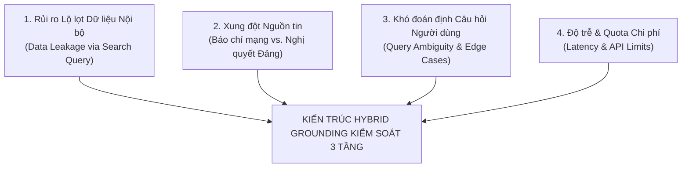
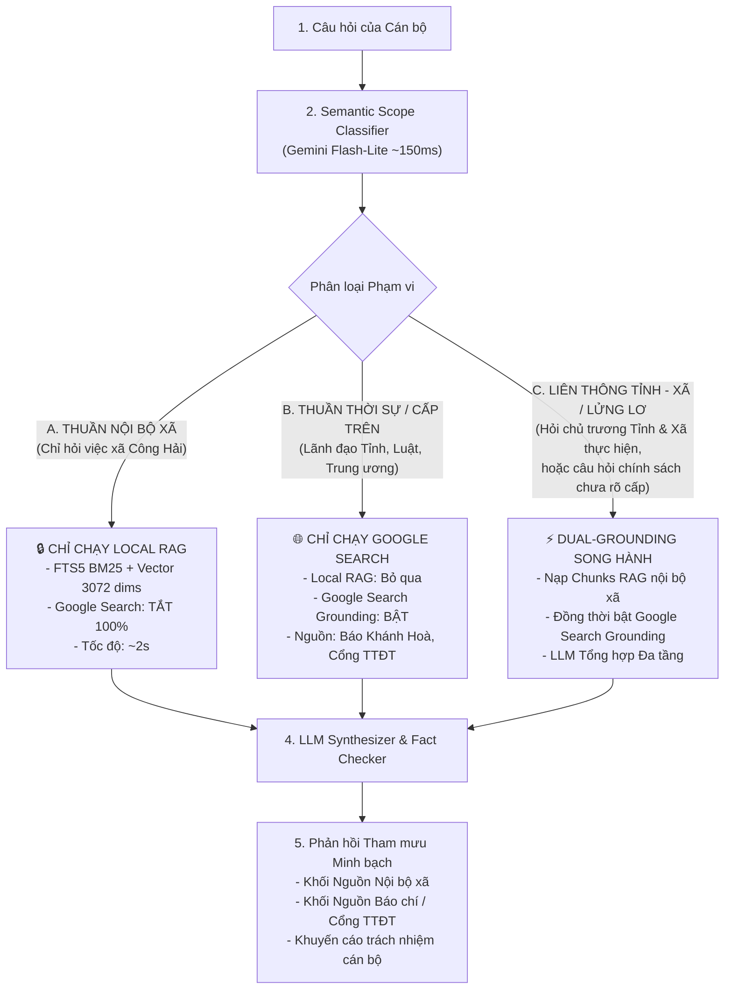

# KẾ HOẠCH KỸ THUẬT: TÍCH HỢP ĐỘNG CƠ HỢP NHẤT DUAL-GROUNDING
## (KHO VĂN BẢN ĐẢNG UỶ XÃ CÔNG HẢI & GOOGLE SEARCH GROUNDING THỜI GIAN THỰC)

> **Cơ quan tham mưu:** Văn phòng Đảng uỷ xã Công Hải, tỉnh Khánh Hoà  
> **Phiên bản:** Kiến trúc v4.0 (Đề xuất Thẩm định Chuyên gia)  
> **Mục tiêu:** Mở rộng năng lực tra cứu thời sự, cấp Tỉnh và Trung ương mà vẫn bảo vệ tuyệt đối an toàn thông tin nội bộ của Đảng uỷ xã.

---

## I. ĐẶT VẤN ĐỀ & BÀI TOÁN THỰC TIỄN

### 1. Hiện trạng hệ thống
Hệ thống Chuyên viên ảo hiện đang vận hành động cơ **True Hybrid RAG** (SQLite FTS5 BM25 + Gemini Embedding 3072 chiều + RRF Fusion). Hệ thống giải quyết rất tốt các bài toán trong phạm vi **Kho tri thức nội bộ khép kín** của Đảng uỷ xã Công Hải nhiệm kỳ 2025 - 2030 (Nghị quyết Đại hội `01-NQ/ĐH`, các nghị quyết chuyên đề từ `02-NQ/ĐU` đến `17-NQ/ĐU`, Kế hoạch `144-KH/ĐU`...).

### 2. Điểm nghẽn nghiệp vụ
Trong thực tế công tác lãnh đạo, chỉ đạo tại cấp xã (mô hình chính quyền địa phương 02 cấp), cán bộ thường xuyên phải xử lý các thông tin vượt ra ngoài kho lưu trữ của xã:
* **Nhân sự cấp trên:** Lãnh đạo Tỉnh uỷ, Thường trực Tỉnh uỷ, lãnh đạo các Sở, ban, ngành của tỉnh Khánh Hoà.
* **Chủ trương thời sự mới:** Các chỉ thị, kết luận, nghị quyết mới ban hành của Ban Thường vụ Tỉnh uỷ Khánh Hoà hoặc Trung ương mà xã chưa kịp nhận văn bản giấy hoặc chưa số hoá vào kho.
* **Quy định pháp luật chung:** Các quy định về đất đai, phụ cấp, ngân sách, chuyển đổi số... theo văn bản của Chính phủ hoặc các Bộ, ngành.
* **Câu hỏi mang tính đối sánh:** *"Tỉnh uỷ Khánh Hoà chỉ đạo thế nào về phát triển du lịch và Đảng bộ xã Công Hải đã cụ thể hoá ra sao?"*

Khi gặp các câu hỏi này, nếu chỉ có RAG nội bộ, AI sẽ buộc phải **từ chối trả lời** (vì kho xã không có) hoặc trả lời cụt lủn, làm giảm hiệu quả tham mưu.

---

## II. CÁC THÁCH THỨC CỐT LÕI CẦN KIỂM SOÁT (RISK AUDIT)

Một bước đi lớn như mở cổng tìm kiếm Internet (Google Search) trong cơ quan Đảng đòi hỏi phải kiểm soát chặt chẽ 04 rủi ro sống còn:



### 1. Rủi ro lộ lọt thông tin nội bộ (Data Privacy Leak)
* **Nguy cơ:** Cán bộ gõ một câu hỏi chứa thông tin nội bộ nhạy cảm (dự thảo nhân sự, kiểm tra dấu hiệu vi phạm, số liệu nội bộ chưa công bố). Nếu hệ thống vô tình gửi nguyên chuỗi ký tự đó lên Google Search API, thông tin có nguy cơ bị lưu vết bên ngoài máy chủ đơn vị.
* **Yêu cầu bắt buộc:** Bắt buộc có lớp **Bộ lọc an toàn dữ liệu (Query Privacy Sanitizer)** trước khi phát lệnh tìm kiếm ra ngoài Internet.

### 2. Rủi ro xung đột thông tin (Conflicting Truths)
* **Nguy cơ:** Thông tin trên mạng xã hội hoặc báo chí có thể viết theo số liệu dự thảo hoặc chưa cập nhật, mâu thuẫn trực tiếp với Nghị quyết chính thức của Đảng uỷ xã (ví dụ: Báo chí nêu chỉ tiêu tăng trưởng 10%, nhưng Nghị quyết Đại hội xã chốt 11 - 12%).
* **Yêu cầu bắt buộc:** Thiết lập **Ma trận Trọng số Thẩm quyền (Hierarchy of Authority)**: Văn bản chính thức của cấp uỷ luôn có giá trị pháp lý cao nhất, đè bẹp (override) mọi nguồn tin mở trên Internet.

### 3. Tính khó đoán định của câu hỏi người dùng (Query Ambiguity)
* **Nguy cơ:** Người dùng không bao giờ hỏi theo đúng cấu trúc kỹ thuật định sẵn. Có người hỏi tắt, hỏi lửng lơ, dùng từ địa phương, hoặc hỏi một câu vừa có việc của Tỉnh vừa có việc của Xã.
* **Yêu cầu bắt buộc:** Tuyệt đối **không dùng Regex cứng hay IF-ELSE** để quyết định đóng/mở Google. Cần dùng cơ chế song hành kết hợp LLM Semantic Gatekeeper.

### 4. Độ trễ phản hồi (Response Latency)
* Google Search Grounding mất trung bình từ 1.5 đến 3.5 giây. Nếu mọi câu hỏi đơn giản trong xã đều kích hoạt tìm kiếm Google thì hệ thống sẽ bị chậm không cần thiết.

---

## III. KIẾN TRÚC GIẢI PHÁP ĐỀ XUẤT: HYBRID GROUNDING 3 TẦNG

Chúng tôi đề xuất mô hình **"Kiểm soát Thông minh — Phối hợp Song hành" (Smart-Gated Parallel Grounding)**:



### Chi tiết 3 mô thức vận hành:

#### 1. Chế độ A — Thuần nội bộ xã (`INTERNAL_ONLY`):
* **Điều kiện kích hoạt:** Câu hỏi chỉ xoay quanh nghị quyết của xã, chi bộ, các thôn, số hiệu văn bản của xã (`-NQ/ĐU`, `-KH/ĐU`, `01-NQ/ĐH`), cán bộ xã.
* **Hành vi:** **Cắt đứt hoàn toàn Google Search**. 100% truy vấn được giữ kín trong CSDL SQLite nội bộ. Đảm bảo tốc độ phản hồi cực nhanh (1.5 - 2s) và bảo mật tuyệt đối.

#### 2. Chế độ B — Thuần bên ngoài / Cấp trên (`EXTERNAL_ONLY`):
* **Điều kiện kích hoạt:** Câu hỏi về lãnh đạo Tỉnh uỷ, Thường trực Tỉnh uỷ, các Sở ngành, văn bản Trung ương, văn bản quy phạm pháp luật, tin tức xã hội.
* **Hành vi:** Không tra cứu CSDL xã để tránh lãng phí slot. Kích hoạt trực tiếp Google Search Grounding để lấy thông tin mới nhất từ các nguồn chính thống: `baokhanhhoa.vn`, `khanhhoa.gov.vn`, `chinhphu.vn`, `nhandan.vn`.

#### 3. Chế độ C — Liên thông Đa tầng Tỉnh - Xã (`HYBRID_DUAL`):
* **Điều kiện kích hoạt:** Câu hỏi so sánh, câu hỏi triển khai (*"Tỉnh chỉ đạo gì và Xã thực hiện thế nào?"*) hoặc các câu hỏi chính sách lửng lơ mà kho xã chưa chắc có.
* **Hành vi:**
  * Kéo tối đa 2 chunks liên quan nhất từ kho văn bản xã Công Hải.
  * Đính kèm công cụ `google_search: {}` của Gemini.
  * Gemini đọc cả 2 nguồn, tự động tổng hợp câu trả lời đa tầng: Vừa có chủ trương của Tỉnh uỷ, vừa có giải pháp thực hiện tại xã Công Hải.

---

## IV. MA TRẬN THẨM QUYỀN NGUỒN (SOURCE AUTHORITY MATRIX)

Khi có thông tin đa nguồn, AI bắt buộc phải tuân theo thứ bậc pháp lý nghiêm ngặt sau:

| Cấp bậc | Loại nguồn | Đại diện tiêu biểu | Trọng số ưu tiên | Nguyên tắc xử lý khi mâu thuẫn |
| :---: | :--- | :--- | :---: | :--- |
| **Bậc 1 (Tối cao)** | **Văn bản Đảng bộ xã Công Hải** | `01-NQ/ĐH`, các Nghị quyết ĐU, Kế hoạch ĐU | **1.0** | **Tuyệt đối ưu tiên.** Mọi số liệu địa phương trong văn bản này là chân lý chính thức. |
| **Bậc 2** | **Cổng TTĐT cơ quan Đảng & Nhà nước** | `khanhhoa.dcs.vn`, `khanhhoa.gov.vn`, `chinhphu.vn` | **0.9** | Căn cứ pháp lý chuẩn xác cho các chủ trương cấp Tỉnh và Trung ương. |
| **Bậc 3** | **Báo chí cách mạng chính thống** | Báo Khánh Hoà, Báo Nhân Dân, TTXVN, QĐND | **0.8** | Căn cứ thông tin thời sự, sự kiện, phát biểu của lãnh đạo. |
| **Bậc 4 (Cấm)** | Mạng xã hội, diễn đàn, blog cá nhân | Facebook, TikTok, blog tự do | **0.0** | **Loại bỏ 100%.** AI không được sử dụng làm căn cứ tham mưu. |

> [!IMPORTANT]
> **Quy tắc giải quyết xung đột:** Nếu báo chí đưa số liệu khác với văn bản lưu trữ của xã, AI bắt buộc phải chỉ rõ: *"Theo Báo chí đưa tin là [X], tuy nhiên theo Nghị quyết số [Y] chính thức của Đảng bộ xã Công Hải, chỉ tiêu được xác lập là [Z]. Đề nghị cán bộ áp dụng theo Nghị quyết chính thức [Z]."*

---

## V. CƠ CHẾ BẢO VỆ DỮ LIỆU NỘI BỘ (QUERY SANITIZER)

Để ngăn ngừa việc lọt thông tin nhạy cảm lên Google Search, một mô-đun lọc chuỗi được đặt trước API:

1. **Danh sách đen từ khoá nhạy cảm (Stoplist):**
   * Nếu câu hỏi chứa các từ: *"Mật"*, *"Tuyệt mật"*, *"Tối mật"*, *"dự thảo nhân sự"*, *"đang thanh tra"*, *"đang kiểm tra dấu hiệu vi phạm"*, *"đơn thư tố cáo"*... $\rightarrow$ **Vô hiệu hoá vĩnh viễn Google Search đối với câu hỏi đó**.
2. **Khử định danh nội bộ (Entity Stripping):**
   * Khi cần tìm kiếm bổ trợ trên Google, hệ thống chỉ trích xuất phần khái niệm chung (ví dụ: *"chỉ tiêu nông thôn mới nâng cao giai đoạn 2026-2030"*) thay vì gửi nguyên văn cả họ tên cán bộ hoặc bối cảnh nội bộ của đơn vị lên công cụ tìm kiếm.

---

## VI. QUY CHUẨN HIỂN THỊ PHẢN HỒI (UI & CITATION STANDARD)

Để cán bộ luôn minh bạch về nguồn gốc thông tin, câu trả lời sẽ luôn được định dạng tách biệt:

```markdown
Dựa trên yêu cầu của đồng chí, tôi xin báo cáo tổng hợp như sau:

🌐 VỀ PHÍA TỈNH UỶ KHÁNH HOÀ (Nguồn: Báo Khánh Hoà / Cổng TTĐT Tỉnh):
- Chủ trương: Khánh Hoà phấn đấu trở thành Thành phố trực thuộc Trung ương vào năm 2030...
- GRDP tăng bình quân 11 - 12%/năm...

📚 VỀ PHÍA ĐẢNG BỘ XÃ CÔNG HẢI (Nguồn: Căn cứ 01-NQ/ĐH ngày 11/08/2025):
- Đảng uỷ xã đã cụ thể hoá: Xã phấn đấu đạt chuẩn "Xã Nông thôn mới nâng cao" trước 2030...
- Tốc độ tăng trưởng giá trị sản xuất toàn xã đạt 11 - 12%/năm...

*Lưu ý: Cán bộ tham mưu chịu trách nhiệm toàn diện về tính chính xác và tính pháp lý của thông tin khi sử dụng thông tin từ AI.*
```

---

## VII. BỘ CÂU HỎI THẨM ĐỊNH DÀNH CHO CHUYÊN GIA CLAUDE

Đồng chí có thể gửi trực tiếp bản kế hoạch này kèm **05 câu hỏi phản biện chuyên sâu** dưới đây cho Chuyên gia Claude để thẩm định và cho ý kiến quyết định:

> ### 📝 5 CÂU HỎI PHẢN BIỆN CHUYÊN GIA (FOR CLAUDE AUDIT):
> 
> 1. **Về Kiến trúc Định tuyến (Routing Architecture):**  
>    Việc sử dụng một lượt phân loại ngữ nghĩa siêu nhẹ (Semantic Scope Classifier bằng Gemini Flash-Lite ~150ms) để chia thành 3 nhánh (`INTERNAL_ONLY`, `EXTERNAL_ONLY`, `HYBRID_DUAL`) có ưu/nhược điểm gì so với việc luôn luôn chạy song hành cả 2 nguồn (Parallel Dual-Grounding)? Phương án nào cân bằng tốt hơn giữa độ trễ (latency), chi phí và trải nghiệm người dùng?
> 
> 2. **Về An toàn & Bảo mật Thông tin Cấp uỷ (Data Privacy):**  
>    Cơ chế "Query Sanitizer" (lọc danh sách từ nhạy cảm và khử định danh) đã đủ an toàn để bảo vệ bí mật công tác Đảng chưa? Có kịch bản tấn công prompt injection hoặc rò rỉ dữ liệu vô tình nào (unintentional data leak) có thể xảy ra khi một hệ thống kết nối với Google Search Grounding không? Cần thêm chốt chặn kỹ thuật nào?
> 
> 3. **Về Giải quyết Xung đột Thông tin (Conflicting Truths & Hallucination):**  
>    Khi thông tin cào từ Internet (Google Search) có độ lệch với tài liệu lưu trữ nội bộ (Local RAG), làm sao để prompt engineering có thể ép mô hình AI luôn ưu tiên dữ liệu nội bộ 100% mà không bị hiện tượng "nhiễm chéo thông tin" (Cross-Source Contamination)?
> 
> 4. **Về Kiểm soát Câu hỏi Mơ hồ (Ambiguous & Under-specified Queries):**  
>    Đối với những câu hỏi cán bộ hỏi rất cộc lốc hoặc dùng tiếng lóng hành chính (ví dụ: *"vụ đất cát bên kia sao rồi"*, *"chế độ của anh em dân quân"*), hệ thống nên xử lý thế nào để không kích hoạt nhầm Google Search gây nhiễu loạn câu trả lời?
> 
> 5. **Đánh giá Khả thi & Lời khuyên Triển khai:**  
>    Với một đơn vị cơ sở cấp xã (Đảng uỷ xã Công Hải), chuyên gia đánh giá kiến trúc này đã ở mức hoàn thiện và an toàn để áp dụng vào thực tế chưa? Cần lưu ý đặc biệt điều gì trong quá trình vận hành lâu dài?
